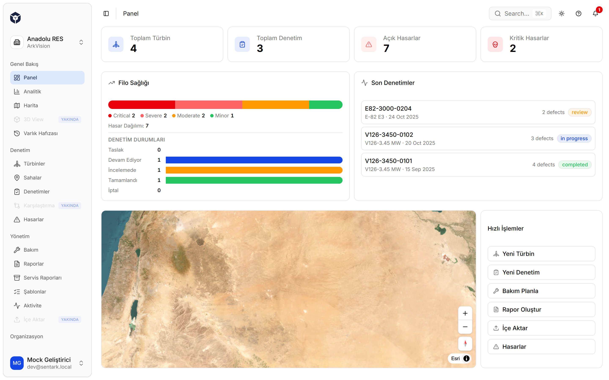
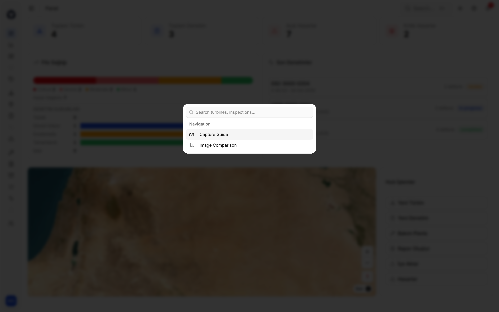
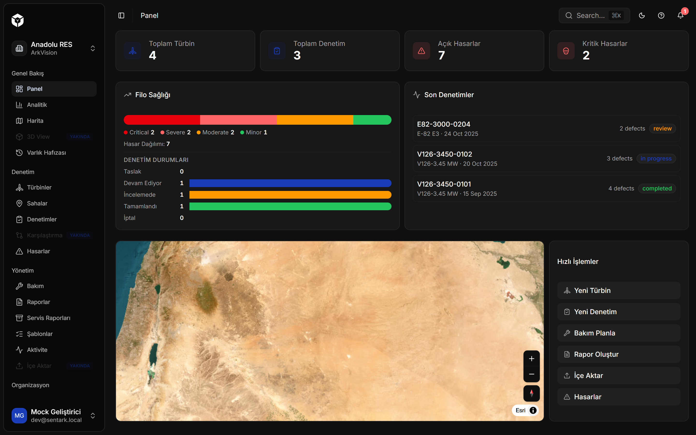
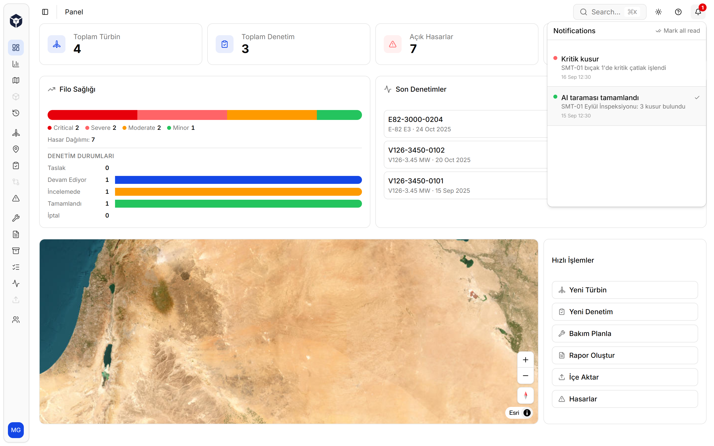

import { Callout } from '@prosefly/astro-components';
import Kbd from '@/components/Kbd.astro';

Giriş yaptıktan sonra karşınıza çıkan ekran üç bölgeden oluşur. Solda menüleri barındıran kenar çubuğu, üstte arama ve bildirimlerin yer aldığı başlık, ortada ise seçtiğiniz sayfanın içeriği bulunur. Bu sayfa üç bölgeyi de tanıtır ve günlük işlerinizi hızlandıracak kısayolları anlatır.

## Sol kenar çubuğu

Kenar çubuğundaki menüler dört grupta toplanır. **Genel Bakış** grubunda panel, analitik, harita ve varlık hafızası bulunur; bunlar filonuzun bütününe bakmak içindir. **Denetim** grubunda türbinler, sahalar, denetimler ve hasarlar yer alır; günlük saha işlerinizin çoğu bu gruptaki sayfalarda geçer. **Yönetim** grubu bakım, raporlar, servis raporları, şablonlar ve aktivite sayfalarını barındırır. **Organizasyon** grubunda ise üyeler ve ayarlar bulunur.

Menülerin yanındaki küçük oklarla kenar çubuğunu daraltabilirsiniz. Daraltıldığında yalnızca ikonlar görünür ve çalışma alanınız genişler. Özellikle tek ekranda uzun tablolarla çalışırken bu görünüm işinizi kolaylaştırır.

Bazı menü öğelerinin yanında "Yakında" rozeti görürsünüz. Bu öğeler hazırlanmakta olan özelliklere aittir ve tıklandığında açılmaz. Hangi özelliklerin yakında geleceğini [SSS](/sss/) sayfasının ilgili bölümünde bulabilirsiniz.

## Üst başlık

Üst başlık, ekranın en üstünde sabit duran şerittir ve gün içinde en çok kullandığınız kontrolleri barındırır.

| Öğe | Ne işe yarar |
|---|---|
| Organizasyon değiştirici | Birden çok organizasyonda geçiş yapmanızı ve yeni organizasyon kurmanızı sağlar |
| Genel arama (<Kbd>Ctrl</Kbd> + <Kbd>K</Kbd>) | Türbin, denetim, hasar ve sayfalar arasında tek kutudan arama yapar |
| Zil simgesi | AI taraması bittiğinde gelen bildirimleri gösterir |
| Tema düğmesi | Açık ve koyu tema arasında geçiş yapar |
| Profil menüsü | Hesap ayarlarına ve çıkışa erişim sağlar |

Genel arama, platformdaki en pratik araçtır. Bir türbin kodunu, denetim başlığını veya hasar numarasını hatırlıyorsanız menülerde dolaşmanıza gerek kalmaz; <Kbd>Ctrl</Kbd> + <Kbd>K</Kbd> ile arama kutusunu açıp yazmaya başlamanız yeterlidir.

## Tur düğmesi

Çoğu sayfanın başlığında **"Tura başla"** düğmesi bulunur. Bu düğme, sayfadaki önemli alanları tek tek vurgulayarak kısa bir tanıtım gezintisi başlatır. Bir ekranı ilk kez açtığınızda veya uzun süre kullanmadığınız bir sayfaya döndüğünüzde turu başlatmak, rehber okumaktan çok daha hızlıdır.

<Callout type="tip" title="Kaybolursanız ilk işiniz turu başlatmak olsun">
  Tur, otuz saniye içinde sayfanın hangi bölümden oluştuğunu ve neyin nerede
  olduğunu gösterir.
</Callout>

## Tema ve dil

Sağ üstteki tema düğmesi açık ve koyu tema arasında geçiş yapar; seçiminiz tarayıcınızda hatırlanır. Dil tercihinizi **Ayarlar → Profil** altından değiştirebilirsiniz; arayüz Türkçe ve İngilizce olarak kullanılabilir. Koyu temada panel şöyle görünür:

## Bildirimler

Uzun süren işlemler arka planda çalışır ve bittiğinde bildirim üretir. En yaygın örnek AI ön taramasıdır: taramayı başlattıktan sonra sayfayı kapatabilirsiniz, tarama sunucuda devam eder ve tamamlandığında zil simgesinde bir bildirim belirir. Bildirim metni kaç görüntünün işlendiğini ve kaçının başarısız olduğunu söyler.

Zil simgesi, okunmamış bildirim sayısını küçük bir rozetle gösterir. Bildirim panelini açıp bir bildirime tıkladığınızda ilgili denetime gidersiniz.

## Aktivite günlüğü

Organizasyonunuzda kimin ne zaman ne yaptığını görmek isterseniz **Aktivite** sayfasına bakın. Bu sayfa tüm işlemleri zaman çizelgesi olarak listeler ve kullanıcı, işlem türü veya tarihe göre filtrelenebilir. "Bu hasarı kim sildi?" gibi soruların cevabı buradadır. Ayrıntı için [Aktivite günlüğü](/aktivite/) sayfasına bakabilirsiniz.
