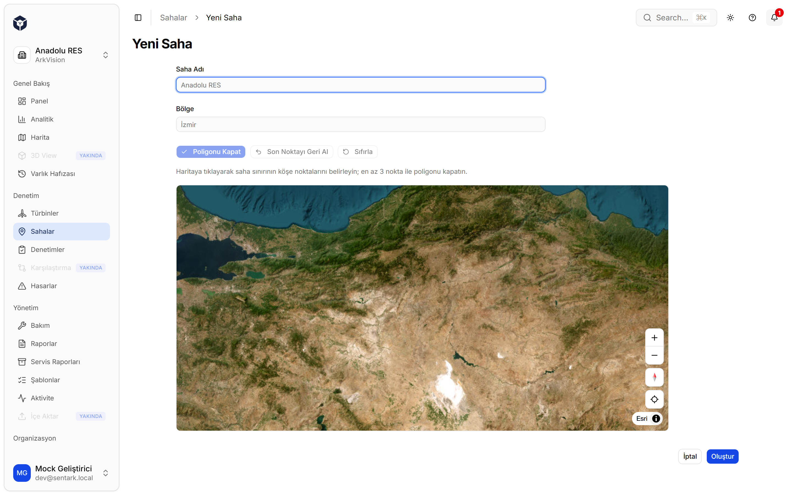
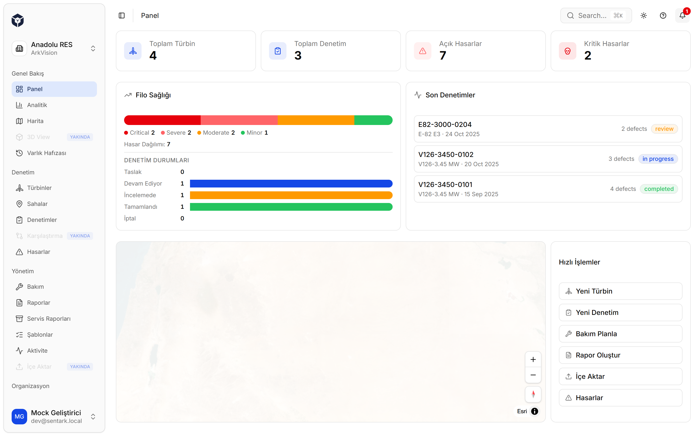
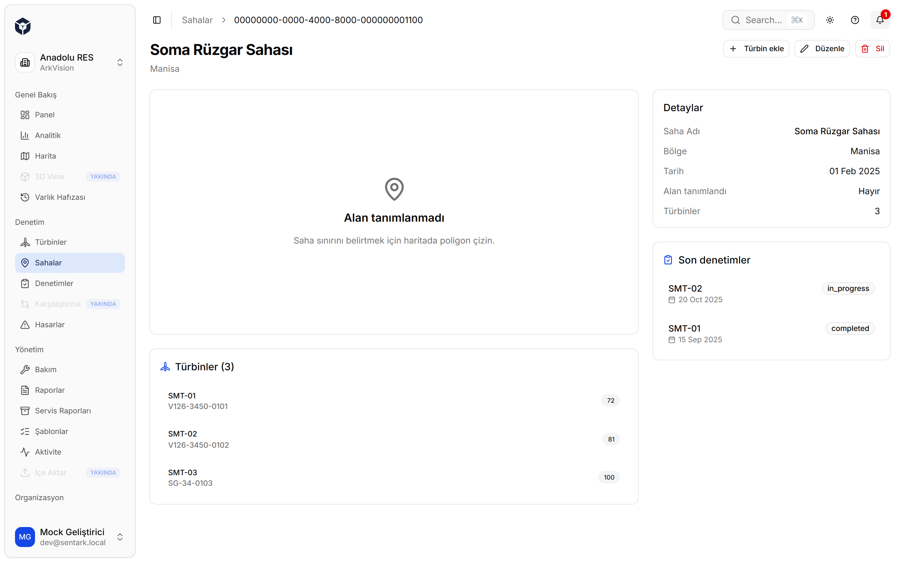

import { AccordionItem, Accordions, Callout, Steps } from '@prosefly/astro-components';

Saha, türbinlerin bulunduğu coğrafi bölgeyi temsil eder. Bir rüzgar santrali genellikle tek bir saha olarak tanımlanır ve sahanın sınırları harita üzerinde çizilebilir. Sahalar zorunlu bir katman değildir, ancak türbinleri bölge bazında gruplamak, haritada bölge sınırlarını görmek ve raporlarda saha adıyla ayrım yapmak istiyorsanız saha tanımlamak işinizi kolaylaştırır.

Saha kaydı yalnızca sahip ve yönetici rollerine açıktır. Denetçi ve operatör sahaları görüntüleyebilir ve saha altındaki türbinlerle çalışabilir, ancak yeni saha oluşturamaz.

## Saha oluşturma

Saha oluşturmak birkaç dakika süren basit bir işlemdir. Formun en önemli kısmı, sahanın sınırlarını haritada çizmektir. Bu adım zorunlu değildir ama saha haritası ve detay görünümü yalnızca sınır çizildiğinde anlamlı olur.

<Steps>

1. **Yeni saha formunu açın**

   Kenar çubuğundan Sahalar sayfasına gidin ve sağ üstteki "Yeni Saha" düğmesine basın.

2. **Saha adını girin**

   Bu alan zorunludur ve sahanın tüm ekranlarda görünecek adıdır. Bölge bilgisi isteğe bağlıdır; birden çok ilde çalışıyorsanız bölgeyi doldurmak listeleme sırasında işinizi kolaylaştırır.

3. **Saha alanını çizin**

   Haritaya tıklayarak sınır köşelerini işaretleyin. En az üç nokta gereklidir. Noktaları yerleştirdikten sonra "Poligonu Kapat" düğmesiyle alanı tamamlayın. İlk noktaya yakın bir yere tıklamak poligonu kendiliğinden kapatır.

4. **Yanlış noktaları düzeltin**

   Son noktayı "Son Noktayı Geri Al" ile tek tek geri alabilir, baştan başlamak için "Sıfırla" düğmesini kullanabilirsiniz.

5. **Kaydedin**

   Saha, türbin sayısı ve son denetimleriyle birlikte listeye eklenir.

</Steps>

<Callout type="tip" title="Alan çizmek zorunlu değil ama önerilir">
  Alan tanımlanmayan sahalar listede "Alan tanımlanmadı" etiketiyle görünür
  ve harita sayfasında bölge sınırı çizilmez. Sonradan saha düzenleme
  ekranından sınır ekleyebilirsiniz.
</Callout>

## Saha listesi

Sahalar sayfası, organizasyonunuzdaki tüm sahaları kartlar halinde listeler. Her kartta saha adı, bölge bilgisi, sahadaki türbin sayısı ve son denetimler özetlenir. Listenin üstündeki arama kutusuyla saha adına göre arama yapabilir, "alana göre filtre" seçeneğiyle yalnızca sınırı çizilmiş veya çizilmemiş sahaları görüntüleyebilirsiniz.

Saha sayısı arttıkça filtreler önem kazanır. Yeni kurulumlarda birkaç saha varken bu bölümü kullanma ihtiyacı duymazsınız; ancak filo büyüdüğünde alan filtresi eksik veri girişini yakalamanın hızlı bir yoludur.

## Saha detayı

Bir karta tıkladığınızda saha detay sayfası açılır. Bu sayfada sahanın haritası, saha altındaki türbinlerin listesi ve sahadaki son denetimler bir arada gösterilir. Detay sayfasından doğrudan yeni türbin ekleyebilirsiniz; eklediğiniz türbin otomatik olarak bu sahaya bağlanır.

Sahayı silmek, altındaki türbinleri silmez. Silme işleminden sonra türbinler sahasız olarak kalır ve listelerde görünmeye devam eder. Bu davranış, yanlışlıkla saha silindiğinde veri kaybını önlemek için tasarlanmıştır.

## Sık sorulanlar

<Accordions>
  <AccordionItem title="Saha olmadan türbin ekleyebilir miyim?">
    Evet. Saha isteğe bağlı bir gruplama katmanıdır ve türbin kaydı saha
    seçilmeden de oluşturulabilir. Yalnızca raporlarda bölge ayrımı ve harita
    görünümü için saha tanımlamak önerilir.
  </AccordionItem>
  <AccordionItem title="Aynı saha için birden çok poligon çizebilir miyim?">
    Bir saha kaydı tek bir alan tanımlar. Farklı bölgelerdeki türbinleri ayrı
    sahalar olarak tanımlamanız, raporlama ve harita görünümü açısından daha
    doğru sonuç verir.
  </AccordionItem>
  <AccordionItem title="Saha sınırını sonradan değiştirebilir miyim?">
    Evet. Saha düzenleme ekranından mevcut poligonu değiştirebilir veya
    sıfırlayıp yeniden çizebilirsiniz. Sınır değişikliği türbinlere dokunmaz.
  </AccordionItem>
</Accordions>
