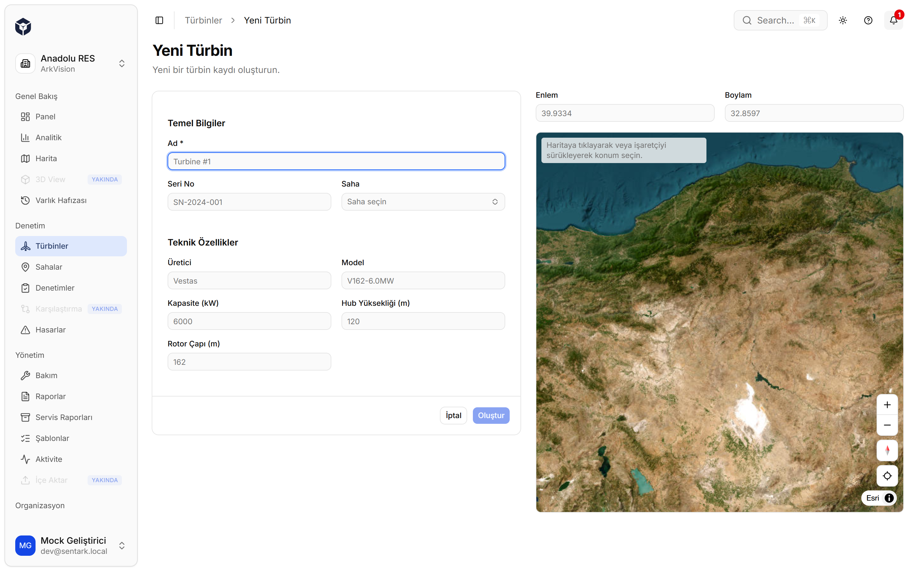
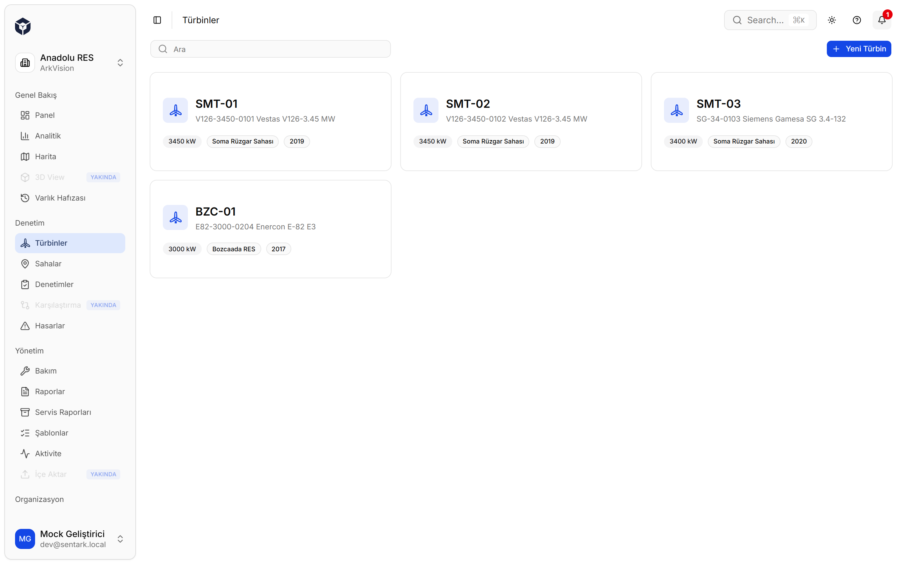
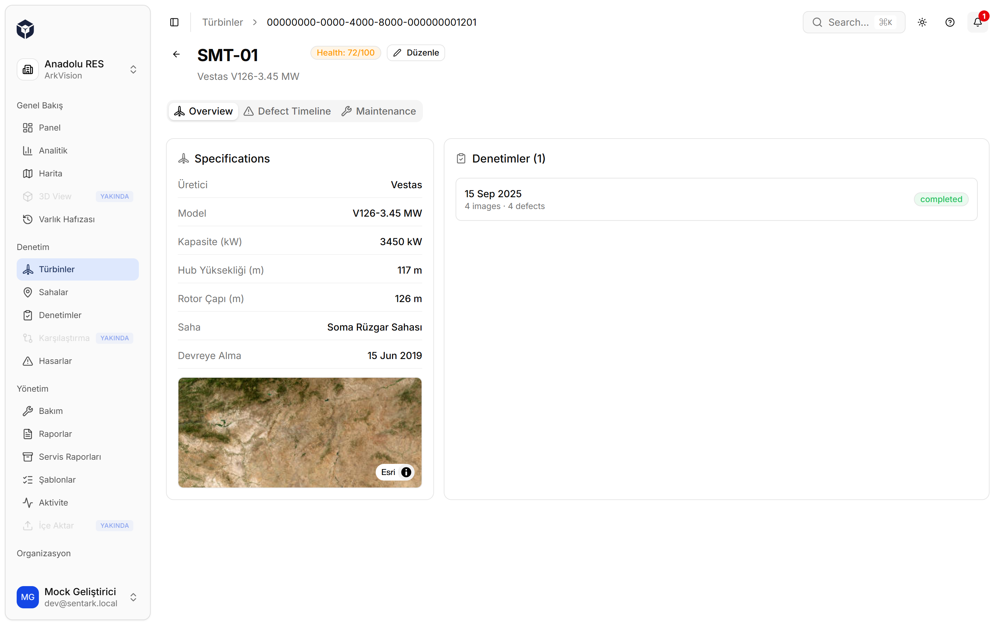

import { AccordionItem, Accordions, Callout, Steps } from '@prosefly/astro-components';

Türbin, Sentark'taki asıl varlıktır. Denetimler türbinlere bağlanır, hasarlar türbinin kanatlarına yerleşir ve sağlık skoru türbin bazında hesaplanır. Bu yüzden filo kurulumunda en çok özen gösterilmesi gereken kayıt türbin kaydıdır. Türbin adının sahada kullandığınız resmi kodla aynı olması, görüntü dosyalarının otomatik eşleşmesi ve raporların okunabilirliği açısından önemlidir.

Sahip, yönetici ve denetçi rolleri türbin oluşturabilir ve düzenleyebilir. Türbin silme yetkisi sahip ve yöneticidedir.

## Türbin ekleme

Türbin formu üç bölümden oluşur: temel bilgiler, teknik özellikler ve konum. Yalnızca türbin adı zorunludur; diğer alanları boş bırakabilir ve daha sonra doldurabilirsiniz. Ancak teknik özellikleri baştan girmek, raporların daha eksiksiz çıkmasını sağlar.

<Steps>

1. **Türbin formunu açın**

   Türbinler sayfasından "Yeni Türbin" düğmesine basın.

2. **Temel bilgileri girin**

   Türbin adı zorunludur; sahada kullandığınız kodu yazın (örneğin SMT-01). Seri numarası ve saha seçimi isteğe bağlıdır.

3. **Teknik özellikleri doldurun**

   Üretici, model, kapasite (kW), hub yüksekliği ve rotor çapı alanları raporlarda ve analiz ekranlarında kullanılır. Bu bilgileri bilmiyorsanız boş bırakın.

4. **Konumu girin**

   Enlem ve boylamı elle yazabilir veya "Haritadan Seç" düğmesiyle harita üzerinde işaretleyebilirsiniz. Haritadan seçtiğinizde işaretçiyi sürükleyerek konumu ince ayar yapabilirsiniz.

5. **Kaydedin**

   Türbin, filo listesine ve varsa saha detayına eklenir.

</Steps>

<Callout type="tip" title="Konum neden önemli">
  Konumu girilen türbinler filo haritasında görünür ve sağlık skoruna göre
  renklenir. Konumsuz türbinler listede yer alır ama haritada görünmez.
</Callout>

## Türbin listesi

Türbinler sayfası filonuzdaki tüm türbinleri kartlar halinde gösterir. Kartlarda türbin adı, bağlı olduğu saha ve sağlık durumu özetlenir. Arama kutusuyla türbin koduna göre arama yapabilir, saha filtresiyle belirli bir bölgedeki türbinleri listeleyebilirsiniz.

## Türbin detayı

Bir türbine tıkladığınızda detay sayfası açılır. Bu sayfa türbinin teknik özetini, sağlık skorunu, kanat şemasını ve geçmiş denetimlerini bir arada gösterir.

**Kanat şeması**, türbinin üç kanadını temsil eder ve her kanatta kaç hasar bulunduğunu gösterir. Hasarların kanat üzerindeki konumu, denetimlerde yapılan kanat ve yüzey eşleştirmesinden gelir. Şemaya bakarak hangi kanadın daha çok incelenmesi gerektiğini hızlıca görebilirsiniz.

**Sağlık skoru**, türbinin denetimlerinde işaretlenen hasarların şiddetinden hesaplanır ve 0 ile 100 arasında bir değer üretir. Kritik şiddetli bir hasar skoru hızla düşürür; küçük hasarların etkisi sınırlıdır. Bu skor panel, harita ve analitik ekranlarında renk kodu olarak kullanılır.

## Sık sorulanlar

<Accordions>
  <AccordionItem title="Türbin adı ne olmalı?">
    Sahada kullandığınız resmi kodu kullanın. Örneğin SMT-01 veya BZC-04
    gibi. Görüntü dosyalarının klasör adları ve rapor başlıkları bu kodla
    eşleştiğinde otomatik tanıma daha isabetli çalışır.
  </AccordionItem>
  <AccordionItem title="Aynı türbini iki saha altında tanımlayabilir miyim?">
    Hayır, bir türbin tek bir sahaya bağlanır. Sahalar arasında taşıma
    yapmak için türbin düzenleme ekranından saha alanını değiştirebilirsiniz.
  </AccordionItem>
  <AccordionItem title="Türbin silindiğinde denetimleri ne olur?">
    Türbin silme işlemi, türbine bağlı denetimleri ve raporları etkiler.
    Geçmişi korumak istiyorsanız türbini silmek yerine pasif duruma almak
    daha güvenli bir yaklaşımdır. Silme yetkisi yalnızca sahip ve yöneticide
    olduğu için bu işlem yanlışlıkla yapılamaz.
  </AccordionItem>
</Accordions>
