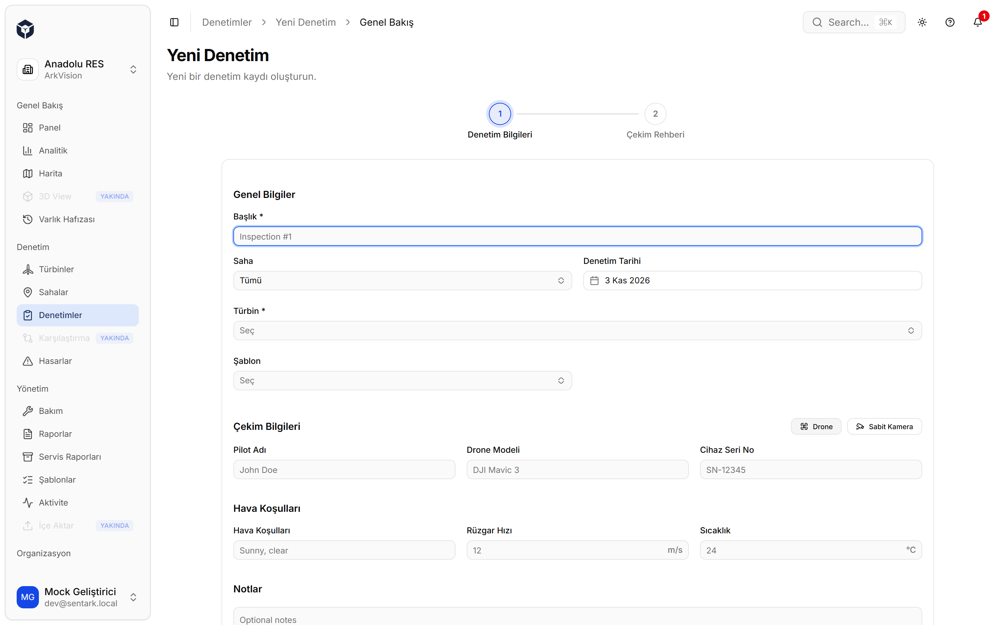
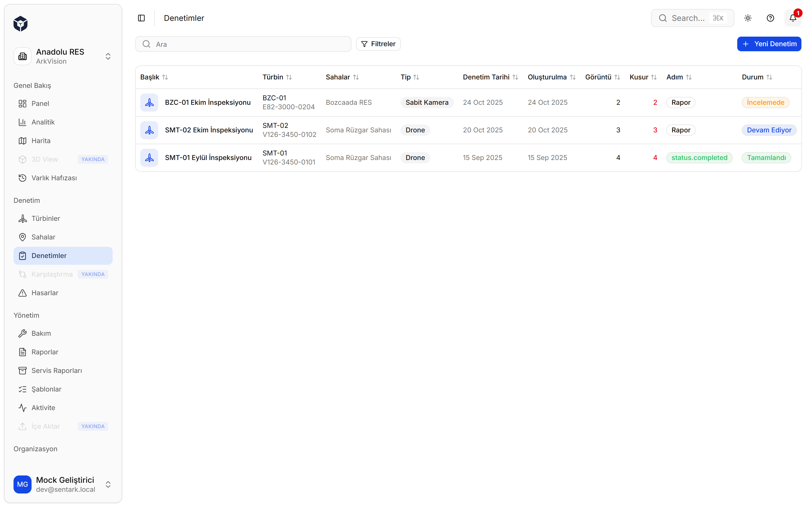

import { Badge, Callout, Icon, Steps } from '@prosefly/astro-components';

Denetim, bir türbinin belirli bir gündeki kanat muayenesini temsil eder. Aynı türbin için yıllar içinde onlarca denetim oluşabilir ve her denetim kendi görüntülerini, hasarlarını ve raporunu taşır. Denetim kaydı, saha çalışmasının tüm ayrıntılarını tek yerde topladığı için hem o günkü koşulları hem de yıllar sonraki karşılaştırmaları mümkün kılar.

Denetim yaşam döngüsü dört aşamadan oluşur. Yeni açılan denetim **Taslak** durumundadır. Görüntü yüklendikçe **Devam Ediyor** olur. AI ön taraması tamamlandığında **İncelemede** durumuna geçer ve inceleme bitip rapor üretildiğinde **Tamamlandı** olarak işaretlenir. Durum rozetleri denetim listesinde her satırda görünür.

  

    <Badge color="neutral" variant="soft">Taslak</Badge>
    denetim oluşturuldu
  

  <Icon name="lucide:arrow-right" class="status-flow__arrow" />
  

    <Badge color="accent" variant="soft">Devam Ediyor</Badge>
    görüntüler yükleniyor
  

  <Icon name="lucide:arrow-right" class="status-flow__arrow" />
  

    <Badge color="warning" variant="soft">İncelemede</Badge>
    AI sonrası insan onayı
  

  <Icon name="lucide:arrow-right" class="status-flow__arrow" />
  

    <Badge color="success" variant="soft">Tamamlandı</Badge>
    rapor üretildi
  

## Denetim oluşturma

Sahip, yönetici, denetçi ve operatör rolleri denetim oluşturabilir. Oluşturma işlemi iki adımlı bir sihirbaz olarak ilerler: önce denetim bilgileri girilir, ardından saha çekimi için hazırlanmış rehber gösterilir.

<Steps>

1. **Yeni denetim sihirbazını açın**

   Kenar çubuğundan Denetimler sayfasına gidin. Tüm denetimler durum rozetleriyle listelenir; sağ üstteki "Yeni Denetim" düğmesine basın.

2. **Denetim bilgilerini girin**

   Başlık ve türbin zorunludur. Türbinü açılır listeden seçebilir veya harita üzerinden işaretleyebilirsiniz.

3. **Şablon seçin (isteğe bağlı)**

   Bir denetim şablonu seçerseniz, o şablonun kontrol listesi denetime eklenir ve saha çalışması sırasında madde madde işaretlenir. Şablonların nasıl çalıştığını [Şablonlar](/sablonlar/) sayfasında bulabilirsiniz.

4. **Çekim yöntemini işaretleyin**

   Drone veya sabit kamera seçeneklerinden birini seçin. Bu seçim, formdaki ek alanları değiştirir: drone seçildiğinde pilot adı ve drone modeli, sabit kamera seçildiğinde operatör adı ve kamera modeli istenir.

5. **Hava koşullarını ve notları girin**

   Hava durumu, rüzgar hızı ve sıcaklık alanları rapora yazılır. Notlar alanına o güne özel gözlemlerinizi ekleyebilirsiniz.

6. **Kaydedin ve çekim rehberini okuyun**

   Denetim oluşturulduğunda saha çekimi için özet bir rehber gösterilir. Rehberde önerilen mesafe, açı, örtüşme oranı ve kanat başına çekilmesi gereken kare sayısı yer alır.

</Steps>

## Çekim rehberi

Saha çekiminin kalitesi, AI ön taramasının ve dolayısıyla raporun kalitesini doğrudan belirler. Rehberde önerilen temel değerler şunlardır: kanada 3 ile 5 metre mesafeden, kanat yüzeyine dik açıyla yaklaşın; ardışık kareler arasında yüzde 70 ile 80 örtüşme bırakın; en az 12 megapiksel çözünürlükle çekin; her kanat için üç yüzeyden toplamda yaklaşık yirmi kare alın.

Bu değerler hasarların hem yakalanmasını hem de farklı karelerde aynı hasarın tekrar tekrar görünmesini sağlar. Örtüşme oranı düşük olursa iki kare arasındaki bir hasar hiç görüntülenmemiş olabilir. Mesafe çok uzaksa küçük hasarlar ayırt edilemez.

<Callout type="note" title="Sahada bu rehbere geri dönmek">
  Rehber, denetim oluşturulduktan sonra da denetim detay sayfasından
  açılabilir. Sahaya çıkmadan önce bir kez gözden geçirmek, dönüşte eksik
  kare olduğunu fark etmekten çok daha iyidir.
</Callout>

## Denetim listesi ve durum takibi

Denetimler sayfası tüm denetimleri tek tabloda listeler. Her satırda denetim başlığı, türbin, durum, görüntü sayısı ve son işlem tarihi görünür. Üstteki filtrelerle duruma göre süzme yapabilir, arama kutusuyla başlık veya türbin koduna göre arama yapabilirsiniz.

Durum rozetleri, bir denetimin hangi aşamada olduğunu tek bakışta anlatır. İncelemede durumundaki denetimler, AI taraması bitmiş ama insan onayı bekleyen işlerdir. Tamamlandı durumundaki denetimlerin raporu üretilmiştir ve normalde yeniden işlem gerektirmez.

## Sonraki adım

Denetim oluşturduktan sonra sıradaki iş görüntüleri yüklemektir. Görüntü yükleme ekranı, klasör yapısını okuyarak kanat ve yüzey atamalarını kendiliğinden yapar. Ayrıntılar için [Görüntü yükleme](/goruntu-yukleme/) sayfasına geçin.
