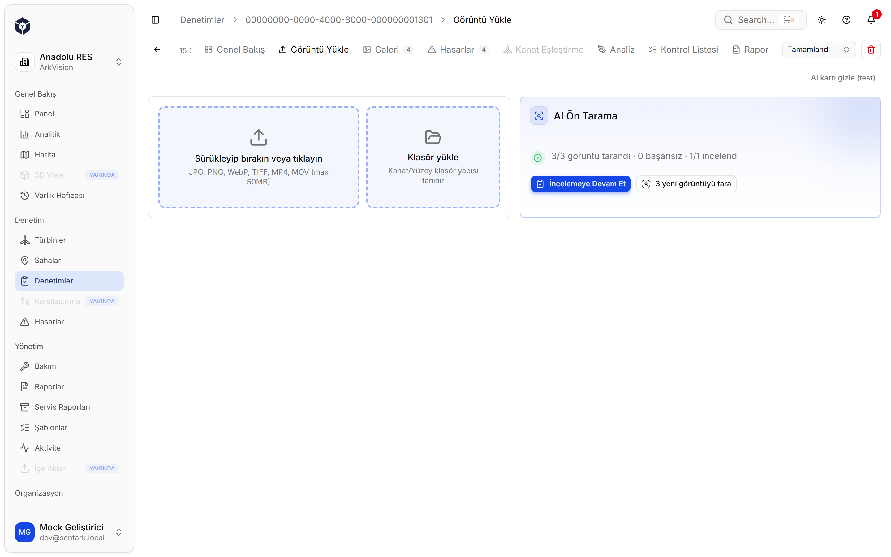

import { Callout, FileTree, Steps } from '@prosefly/astro-components';

Denetim oluşturduktan sonraki adım, saha çalışmasında çekilen fotoğraf ve videoları sisteme yüklemektir. Sentark, tek seferde yüzlerce dosyayı kabul eder ve her dosyayı yüklenmeden önce kalite kontrolünden geçirir. Bu sayfa yükleme akışını, klasör yapısının neden önemli olduğunu ve yükleme sırasında karşılaşabileceğiniz durumları anlatır.

## Yükleme ekranı

Denetim detay sayfasındaki **Görüntü Yükle** sekmesi yükleme işleminin merkezidir. Operatör dahil tüm roller görüntü yükleyebilir; bu, sahada görüntü toplayan ekiplerin sisteme doğrudan erişebilmesi için tasarlanmıştır.

Ekranda iki alan bulunur: solda sürükle-bırak alanı, sağda AI ön tarama kartı. Sürükle-bırak alanına dosyalarınızı bırakabilir, tıklayarak dosya seçebilir veya **"Klasör yükle"** ile tüm bir klasörü olduğu gibi ekleyebilirsiniz. Klasör yükleme seçeneği, saha çalışmasından dönen ekipler için en pratik yoldur.

Desteklenen dosya biçimleri JPG, PNG, WebP, TIFF, MP4 ve MOV'dur. Dosya başına üst sınır 50 megabayttır. Videolar da yüklenebilir; kare çıkarma işlemi tarama aşamasında yapılır.

## Klasör yapısı neden önemli

Yüklediğiniz dosyaların klasör yolları kaydedilir ve görüntünün hangi kanada, hangi yüzeye ait olduğunu tahmin etmek için kullanılır. Standart bir klasör düzeni kullandığınızda kanat ve yüzey atamaları kendiliğinden yapılır, siz yalnızca gözden geçirirsiniz.

<FileTree>

- denetim-2025-10-24
  - K1
    - HE
      - IMG_0012.jpg
      - IMG_0013.jpg
    - FE
      - IMG_0130.jpg
  - K2
    - HE
    - FE
  - K3
    - HE
    - FE

</FileTree>

Yukarıdaki örnekte K1, K2 ve K3 kanatları temsil eder; HE hücum kenarını, FE firar kenarını gösterir. Sistem bu adları tanır ve yükleme sonunda kaç dosyada kanat ve yüzey bilgisinin tanındığını özetler. Klasör adları farklı bir düzende gelirse dosyalar "atanmamış" olarak kalır ve atamayı elle yapmanız gerekir. Bu durumda [Kanat ve yüzey eşleştirme](/kanat-eslestirme/) sayfasındaki adımları izleyin.

<Callout type="tip" title="Klasör adlarını sahada standarda bağlayın">
  Ekipleriniz farklı klasör adlandırma alışkanlıkları kullanıyorsa, saha
  çekiminden önce tek bir düzen üzerinde anlaşmak uzun vadede en çok zaman
  kazandıran adımdır.
</Callout>

## Kalite kontrolü

Her dosya yüklenmeden önce iki kontrolden geçer: çözünürlük ve dosya bütünlüğü. Sonuç üç gruba ayrılır.

**Uygun** dosyalar sorunsuz yüklenir. **Düşük Çözünürlük** grubundaki dosyalar yüklenir ancak raporda uyarı olarak işaretlenir, çünkü düşük çözünürlüklü görüntülerde küçük hasarlar gözden kaçabilir. **Hatalı** grubundaki dosyalar ise hiç yüklenmez; bu dosyalar bozuk, okunamayan veya desteklenmeyen biçimdedir.

DNG, RAW ve HEIC gibi biçimler tarayıcıda açılamaz. Bu dosyaları yüklemeden önce JPEG'e dönüştürmeniz gerekir. Telefonla çekim yapan ekiplerde en sık karşılaşılan sorun budur.

## Yükleme listesi ve ilerleme

Yükleme başladığında ekranda dosya bazlı bir liste belirir. Her satırda dosya yolu, boyut ve durum görünür: Bekliyor, Yükleniyor veya Yüklendi. Liste tablo ya da ağaç görünümünde izlenebilir; ağaç görünümü klasör hiyerarşisini koruyarak gösterir ve kalabalık yüklemelerde daha okunaklıdır.

Listenin üstündeki arama kutusuyla dosya adına veya yola göre arama yapabilirsiniz. Kanat ve yüzeye göre filtreleme de mümkündür; böylece belirli bir kanadın karelerinin yüklenip yüklenmediğini hızlıca doğrularsınız.

<Callout type="note" title="Yükleme ilerlemesi görüntüsü">
  📷 Yükleme sırasında her dosya için ayrı ilerleme çubuğu ve durum etiketi
  görünür. Bu ekranın görüntüsü canlı ortamdan eklenecek.
</Callout>

## Yükleme sonrası kontrol

Yükleme tamamlandığında denetimin **Genel Bakış** sekmesi güncellenir. Burada toplam görüntü sayısı, kanat kapsama haritası ve varsa atanmamış görüntü uyarısı görünür. Atanmamış görüntü varsa hasarların konumlandırılması ve gruplanması çalışmaz, bu yüzden yükleme sonrası bu uyarıyı kontrol etmek önemlidir.

Yanlış yüklenen bir görüntüyü listeden kaldırabilirsiniz. Görüntü silme işlemi, o görüntüye bağlı anotasyonları da siler; bu nedenle inceleme başladıktan sonra görüntü silmek dikkat gerektirir.

## Sonraki adım

Görüntüler yüklendikten sonra sıradaki adım kanat ve yüzey atamalarını doğrulamaktır. Yükleme sırasında otomatik tanıma çalıştıysa bu adımı hızlıca geçebilirsiniz. Ayrıntılar için [Kanat ve yüzey eşleştirme](/kanat-eslestirme/) sayfasına geçin.
