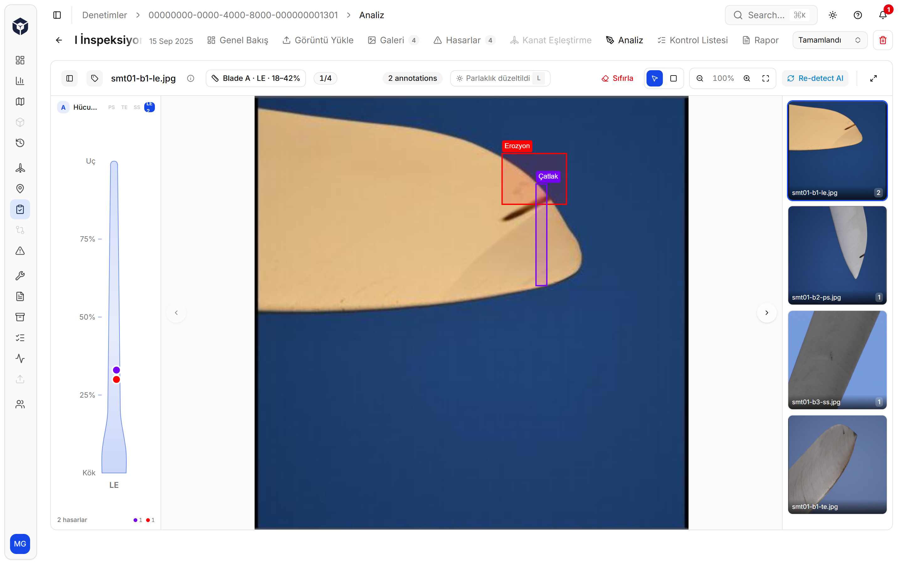

import { Callout, Tabs, TabItem } from '@prosefly/astro-components';

Bir kanat fotoğrafının hangi kanada ve hangi yüzeye ait olduğu, o fotoğrafta işaretlenen hasarların türbin üzerindeki konumunu belirler. Bu bilgi olmadan hasarlar listelenebilir ama haritada gösterilemez, sağlık skoruna doğru katkı yapamaz ve aynı hasarın farklı kareleri tek bulguda birleşemez. Bu yüzden kanat ve yüzey eşleştirmesi, denetimin en kritik veri adımıdır.

Her görüntü üç bilgi taşır. **Kanat**, türbinin üç kanadından hangisi olduğunu söyler ve A, B, C olarak etiketlenir. **Yüzey**, kanadın hangi tarafından çekildiğini belirtir: LE hücum kenarı, TE firar kenarı, PS basınç yüzeyi ve SS emme yüzeyi. **Kapsam**, görüntünün kanat boyunca hangi aralığı gösterdiğini yüzde olarak ifade eder; yüzde sıfır kanat kökü, yüzde yüz kanat ucudur.

## İki yol: otomatik tanıma ve elle düzeltme

Kanat bilgisi iki şekilde oluşur. İlk yol, yükleme sırasında dosya yollarından otomatik tanımadır ve çoğu durumda yeterlidir. İkinci yol, tanınamayan görüntüleri Analiz ekranında elle düzeltmektir. İki yöntem birbirini tamamlar.

<Tabs>
  <TabItem label="Otomatik tanıma">
    Dosya yolu veya dosya adı standart bir düzene uyuyorsa kanat ve yüzey bilgisi
    yükleme sırasında kendiliğinden doldurulur. Örneğin `smt01-b1-le.jpg` gibi
    bir dosya adı veya `K1/HE/` gibi bir klasör yolu tanınır. Yükleme sonunda
    kaç dosyada kanat ve yüzey klasörünün tanındığını gösteren bir özet çıkar.

    Tanınmayan dosyalar "atanmamış" olarak kalır. Yükleme listesindeki kanat ve
    yüzey filtrelerini kullanarak bu dosyaları bulabilir ve elle
    düzeltebilirsiniz. Otomatik tanımanın çalışması için en etkili yöntem,
    [Görüntü yükleme](/goruntu-yukleme/) sayfasında anlatılan klasör düzenini
    kullanmaktır.
  </TabItem>
  <TabItem label="Analiz ekranında elle düzeltme">
    Analiz ekranının sol tarafında kanat haritası paneli bulunur. Bu panelde
    görüntünün kanadını (A, B veya C) ve yüzeyini (LE, TE, PS veya SS) seçersiniz.
    Seçim yaptığınız anda görüntü bu bilgiyle etiketlenir.

    Panelin altındaki **Kanat Kapsama** bandı, görüntünün kanat boyunca hangi
    aralığı gösterdiğini işaretlemenizi sağlar. Bandın iki ucunu sürükleyerek
    başlangıç ve bitiş yüzdelerini belirlersiniz. Kapsam bilgisi kare bazında
    kaydedilir.
  </TabItem>
</Tabs>

## Kapsam aralığı neden gerekli

Kapsam aralığı, hasar gruplamasının temelidir. Aynı çatlağı üç farklı kareden çektiyseniz üç ayrı anotasyon oluşur. Sistem bu anotasyonları tek hasarda birleştirirken kanat, yüzey ve tipin yanı sıra kapsamların birbirine yakın olmasına bakar. Kapsam bilgisi girilmemişse sistem hasarın kanadın neresinde olduğunu bilemez ve birleştirme yapamaz.

Bu yüzden özellikle birbirini izleyen karelerde kapsamları dikkatli işaretlemek, hasar listesinin doğru oluşması için doğrudan etkilidir. Kapsamları sonradan girmek de mümkündür; sistem yeni bilgiyle gruplamayı yeniden hesaplar.

<Callout type="warning" title="Kanat Eşleştirme sekmesi henüz devre dışı">
  Denetim sayfasındaki ayrı "Kanat Eşleştirme" sekmesi, görüntüleri
  sürükle-bırak ile havuzlara atamayı sağlayacak bir özelliktir ve bu sürümde
  devre dışıdır. Atamaları bu sayfada anlatılan iki yolla yapın.
</Callout>

## Eşleştirmeyi kontrol etmenin pratik yolu

Denetimin Genel Bakış sekmesindeki kanat kapsama haritası, hangi kanat ve yüzeylerin hangi aralıklarla görüntülendiğini gösterir. Bu haritada boş kalan bölgeler varsa ya o bölgeden fotoğraf çekilmemiştir ya da eşleştirme eksik yapılmıştır. İki durumu ayırt etmenin yolu yükleme listesindeki atanmamış dosya sayısına bakmaktır. Atanmamış dosya yoksa ve haritada boşluk varsa, saha çekiminde o bölge atlanmış demektir.

## Sonraki adım

Eşleştirme tamamlandığında denetim AI ön taramasına hazırdır. Galeri ve kontrol listesi ekranlarını tanımak için [Galeri ve kontrol listesi](/galeri-kontrol-listesi/) sayfasına, taramayı başlatmak için [AI ön tarama](/ai-on-tarama/) sayfasına geçebilirsiniz.
