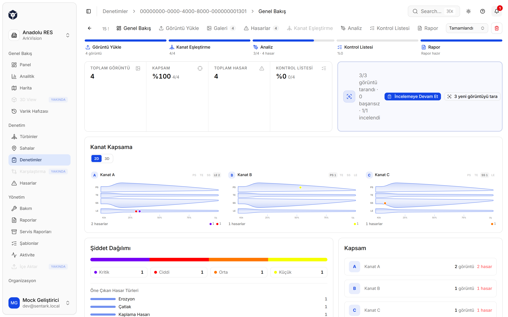
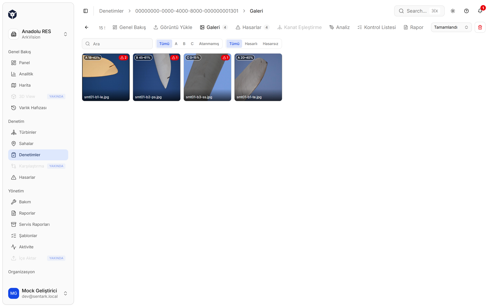
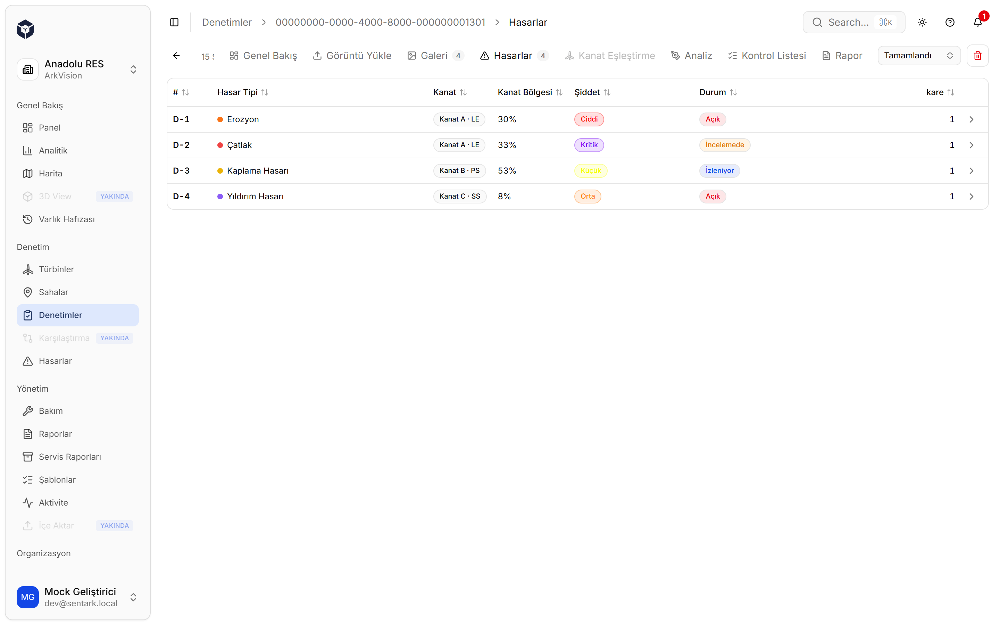
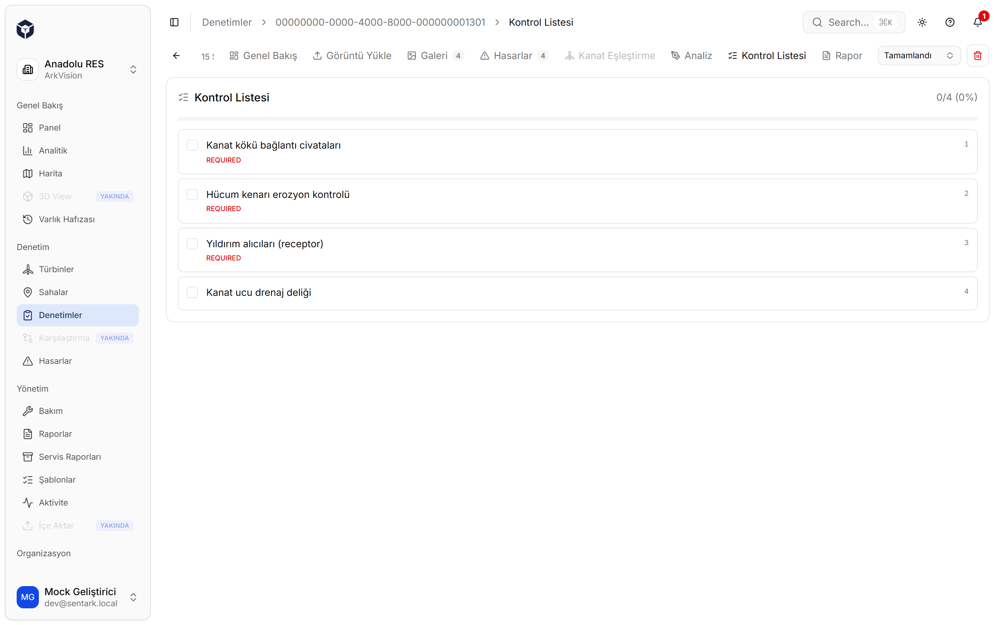

import { Callout } from '@prosefly/astro-components';

Denetim detay sayfası, bir denetimin tüm verilerini sekmeler halinde sunar. Bu sayfa sekmelerin ne işe yaradığını ve günlük kontrollerde hangi sekmeden başlamanız gerektiğini anlatır. Yükleme ve inceleme işleri tamamlandıktan sonra denetimi son bir kez gözden geçirmek için bu ekranları kullanırsınız.

## Genel bakış sekmesi

Genel Bakış, denetimin özet ekranıdır. Üst kısımda toplam görüntü sayısı, toplam hasar sayısı ve şiddet dağılımı yer alır. Altında kanat kapsama haritası, denetimde kullanılan şablonun kontrol listesi ve çekim bilgileri bulunur. Bu ekran, denetimin tamamlanmaya ne kadar yakın olduğunu anlamanın en hızlı yoludur.

Şiddet dağılımı, hasarların kaçının kritik, ciddi, orta ve küçük olduğunu gösterir. Kritik hasar sayısı, rapor ve bakım planı açısından en çok dikkat edilmesi gereken göstergedir. Kanat kapsama haritası ise görüntülerin kanat boyunca hangi aralıkları kapsadığını göstererek eksik çekim bölgelerini işaret eder.

## Galeri

Galeri sekmesi, denetimdeki tüm kareleri küçük resimler halinde gösterir. Bu ekran özellikle yükleme sonrası doğrulama için kullanılır: dosyaların doğru yüklendiğini, kanat atamalarının tutarlı olduğunu ve eksik kare bulunmadığını buradan kontrol edebilirsiniz.

Galeride iki filtre bulunur. **Hasarlı / hasarsız** filtresi, yalnızca hasar işaretlenmiş veya hiç hasar işaretlenmemiş kareleri gösterir. **Kanat filtresi** ise belirli bir kanadın karelerine odaklanmanızı sağlar. Bir kareye tıkladığınızda görüntü Analiz ekranında açılır ve üzerinde çalışabilirsiniz.

<Callout type="tip" title="Kanata atanmamış görüntü uyarısı">
  Galeride "görüntü kanata atanmamış" uyarısı görürseniz, ilgili karelerin
  kanat ve yüzey bilgisi eksiktir. Bu kareler hasar gruplamasına katılamaz.
  <a href="/kanat-eslestirme/">Kanat ve yüzey eşleştirme</a> sayfasındaki
  adımlarla eksikleri tamamlayın.
</Callout>

## Hasarlar sekmesi

Hasarlar sekmesi, bu denetime ait hasarları tablo halinde listeler. Her satırda hasarın tipi, kanadı, kanat bölgesi yüzdesi, şiddeti, durumu ve kaç karede göründüğü yer alır. Bu tablo, organizasyon genelindeki [Hasarlar](/hasarlar/) sayfasının denetim bazına indirgenmiş halidir.

Tablo, rapor öncesi son kontrol için idealdir. Özellikle "kaç karede görünüyor" sütunu, gruplamanın doğru çalışıp çalışmadığını gösterir. Bir hasar tek karede görünüyorsa ya hasar gerçekten yalnızca bir açıdan yakalanmıştır ya da diğer karelerdeki kapsam bilgisi eksiktir.

## Kontrol listesi

Denetim oluştururken bir şablon seçtiyseniz, Kontrol Listesi sekmesi o şablonun maddelerini gösterir. Maddeler saha çalışması sırasında tek tek işaretlenir ve tamamlanma durumu denetimle birlikte saklanır. Şablon seçilmediyse bu sekme görünmez.

Kontrol listesi, kanat kökü civataları, hücum kenarı erozyonu ve receptor kontrolü gibi düzenli tekrarlanan işleri kapsar. Her denetimde aynı maddelerin kontrol edilmesini sağladığı için denetim kalitesinin ekipten ekibe değişmesini engeller. Şablonların nasıl oluşturulduğunu [Şablonlar](/sablonlar/) sayfasında bulabilirsiniz.

## Hangi sekmeden başlamalı

Yeni bir denetimde sıralama genellikle şöyledir: önce Genel Bakış ile durumu görmek, ardından Galeri ile yüklemeyi doğrulamak, sonra AI taramasını başlatıp incelemeye geçmek. İnceleme bittikten sonra Hasarlar sekmesiyle gruplamayı kontrol etmek ve son olarak raporu üretmek. Kontrol listesi varsa saha dönüşünde hemen işaretlenir.
