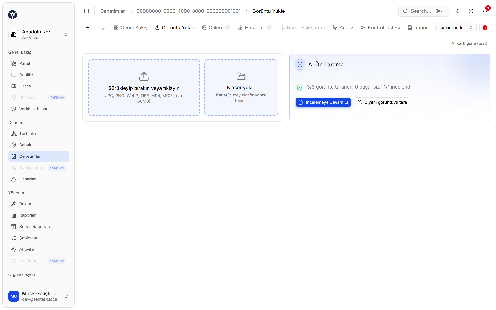

import { Callout, Steps } from '@prosefly/astro-components';

AI ön tarama, yüklenen görüntüleri hasar modellerinden geçirerek olası hasarları kutular halinde işaretler. Amacı denetçinin işini hızlandırmaktır: boş bir fotoğrafta hasar aramak yerine, önerilen kutuları gözden geçirip onaylamak veya düzeltmek çok daha hızlıdır. Ancak taramanın ürettiği her kutu bir öneridir, kesin hasar değildir. Son karar her zaman insan denetçidedir.

Bu ayrım yalnızca bir sorumluluk meselesi değildir. Modeller, fotoğraftaki işaretleri, gölgeleri veya boya kalıntılarını hasar sanabilir. İnceleme aşaması tam da bu yanlış önerileri ayıklamak için vardır ve yanlış kutuların nedeniyle birlikte silinmesi modellerin gelecekte daha az yanılmasına katkı sağlar.

## Taramayı başlatma

Sahip, yönetici ve denetçi rolleri tarama başlatabilir. Operatör ve izleyici rolleri tarama başlatamaz, ancak sonuçları görüntüleyebilir.

<Steps>

1. **AI Ön Tarama kartını bulun**

   Denetim detay sayfasında Görüntü Yükle sekmesine gidin. Sayfanın sağındaki kart, taranmayı bekleyen görüntü sayısını gösterir.

2. **Taramayı başlatın**

   "Taramayı Başlat" düğmesine basın. İşler kuyruğa alınır ve tarama sunucuda başlar.

3. **İlerlemeyi izleyin**

   Kart üzerindeki canlı ilerleme, kaç görüntünün işlendiğini ve tahmini kalan süreyi gösterir.

4. **Sayfadan ayrılabilirsiniz**

   Tarama sunucuda devam eder. Tamamlandığında bildirim gelir ve denetim otomatik olarak İncelemede durumuna geçer.

</Steps>

## Eşzamanlılık ve kuyruk davranışı

Taramalar arka planda sıraya alınarak çalışır. Aynı denetim için aynı anda tek tarama çalıştırılabilir. Organizasyon genelinde ise aynı anda en fazla iki tarama işlem görür. Bu sınır, model sunucusunun kaynaklarını korumak için konulmuştur. Sınır doluysa başlattığınız tarama kuyrukta bekler ve sırası geldiğinde otomatik başlar.

Tarama bittikten sonra yeni görüntü yüklerseniz, tüm görüntüleri yeniden taramak yerine **"X yeni görüntüyü tara"** düğmesiyle yalnızca yeni eklenenleri tarayabilirsiniz. Bu davranış, büyük denetimlerde zaman kaybını önler.

## İptal

Taramayı istediğiniz an iptal edebilirsiniz. İptal ettiğinizde kuyrukta bekleyen görüntüler işlenmez, ancak tamamlanmış görüntülerin sonuçları korunur. Yani iptal, baştan başlamak anlamına gelmez; kaldığınız yerden yeniden başlatabilirsiniz.

<Callout type="note" title="Canlı ilerleme görüntüsü">
  📷 Tarama sürerken kart üzerinde yüzde ilerlemesi ve tahmini süre görünür.
  Bu durumun görüntüsü canlı ortamdan eklenecek.
</Callout>

## Sorunlar ve uyarılar

Kart üzerinde **"Pipeline yanıt vermiyor"** uyarısı görürseniz model sunucusu devre dışı demektir. Bu durumda yapabileceğiniz bir işlem yoktur; organizasyon yöneticinize bilgi verin. Servis yeniden başlatıldığında taramayı tekrar başlatabilirsiniz.

Tarama tamamlandığı halde bazı görüntüler işlenmemiş olabilir. Bildirim metni kaç görüntünün başarısız olduğunu gösterir. Başarısız görüntüler genellikle bozuk dosya veya desteklenmeyen biçim kaynaklıdır; dosyayı değiştirip yeniden yükleyebilirsiniz.

## Taramanın sonucu

Tarama tamamlandığında her görüntü için bulunan kutular kaydedilir ve denetim inceleme aşamasına geçer. Bu aşamada henüz hiçbir kutu "hasar" olarak sayılmaz; hasarlar ancak inceleme sırasında onaylandığında veya düzenlendiğinde oluşur.

İnceleme akışını [İnceleme](/inceleme/) sayfasında, elle kutu ekleme ve düzenlemeyi [Annotation Studio](/annotation-studio/) sayfasında bulabilirsiniz.
