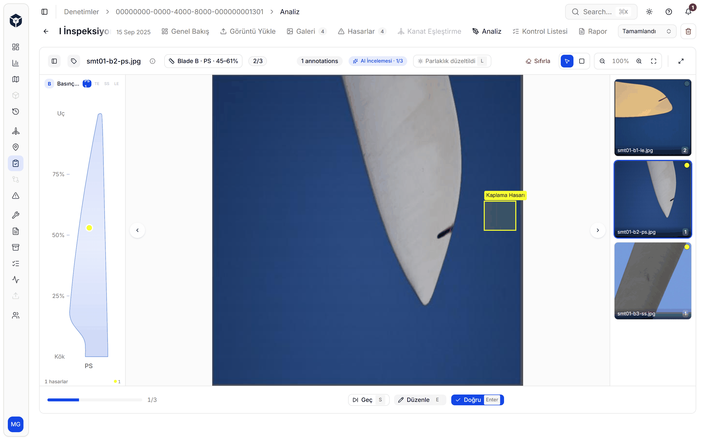

import { Callout, Steps } from '@prosefly/astro-components';
import Kbd from '@/components/Kbd.astro';

İnceleme, AI ön taramasının ürettiği kutuları tek tek gözden geçirip karara bağladığınız aşamadır. Denetimin kalitesi büyük ölçüde bu aşamada belirlenir: onaylanan her kutu rapora girer, silinen her yanlış kutu raporu temizler. Deneyimli bir denetçi, iyi çekilmiş bir denetimde görüntü başına birkaç saniyede ilerleyebilir.

Tarama tamamlandığında denetim **İncelemede** durumuna geçer ve inceleme ekranı kullanıma açılır. Denetim detayındaki **"İncelemeye Başla"** düğmesi Analiz sekmesini inceleme modunda açar. Karşınıza her görüntü, üzerinde AI kutularıyla gelir.

## Üç karar

İnceleme ekranında her görüntü için üç karardan birini verirsiniz.

**Doğru** kararı, kutuların olduğu gibi doğru olduğunu söyler. Hasarlar bu haliyle onaylanır ve rapora girer. **Düzenle** kararı, kutularda değişiklik yaptığınızı belirtir. Kutu taşıdıysanız, sınıfı değiştirdiyseniz veya şiddeti güncellediyseniz bu karar kullanılır. Aslında bir karede değişiklik yaptığınız anda karar kendiliğinden düzenlendi durumuna geçer, ayrıca düğmeye basmanız gerekmez. **Geç** kararı, bu kareye şimdi karar vermeden sonrakine geçmenizi sağlar. Geçtiğiniz kareler kaybolmaz; incelemenin sonunda "Geçilenleri İncele" ile geri dönebilirsiniz.

| Karar | Kısayol | Anlamı |
|---|---|---|
| **Doğru** | <Kbd>Enter</Kbd> | Kutular doğru, hasarlar onaylandı |
| **Düzenle** | <Kbd>E</Kbd> | Kutularda değişiklik yapıldı |
| **Geç** | <Kbd>S</Kbd> | Şimdi karar vermeden sonraki kareye geç |

## Klavye ile hızlı ilerleme

İnceleme ekranı klavye kullanımı için tasarlanmıştır. <Kbd>Enter</Kbd> ile onaylayıp bir sonraki kareye geçmek, fare kullanmaktan kat kat hızlıdır. Bir karede şüpheli bir kutu varsa <Kbd>E</Kbd> ile düzenleme moduna geçer, kutuya tıklayıp sınıfını veya şiddetini değiştirirsiniz. Karar veremediğiniz kareleri <Kbd>S</Kbd> ile geçip sonra dönebilirsiniz.

İlerleme ekranın üstünde "X/Y incelendi" biçiminde gösterilir. İncelemeyi istediğiniz an kapatabilirsiniz; kaldığınız yerden devam etmek için denetim detayındaki inceleme düğmesini kullanın.

<Callout type="tip" title="Karanlık karelerde L tuşu">
  AI, karanlık görüntülerde okunabilirliği artırmak için parlaklık düzeltmesi
  uygular. <Kbd>L</Kbd> tuşu bu düzeltmeyi açıp kapatır; kutunun ham
  görüntüde de doğru göründüğünü kontrol etmek için kullanın.
</Callout>

## Yanlış kutuları silmek

AI bazen gerçek hasar olmayan şeyleri işaretler. Boya kalıntısı, kuş pisliği, gölge veya yansıma bunların en yaygın örnekleridir. Bir kutuyu silerken sistem size isteğe bağlı bir neden sorar: işaret veya boyalı ok, kir veya leke, gölge veya yansıma, arka plan, kopya tespit ve diğer. Klavyeden 1 ile 6 arasındaki tuşlarla neden seçebilir, Esc ile vazgeçebilirsiniz.

Neden seçmek zorunlu değildir; "Nedensiz sil" seçeneği de vardır. Ancak neden belirtmek bir saniyenizi alır ve modellerin iyileştirilmesine katkı sağlar. Bu geri bildirimler, organizasyonunuz model eğitimine katkı iznini açtıysa eğitim verisine dahil edilir.

## Tek model rozeti

Bir kutunun yanında **"Tek model"** rozeti görüyorsanız, o kutuyu yalnızca bir model tespit etmiştir. Birden çok modelin üzerinde anlaştığı kutular daha güvenilir kabul edilir. Tek model rozetli kutuları incelerken biraz daha dikkatli olmak, yanlış onay riskini azaltır.

## İncelemenin rapora etkisi

İnceleme tamamlandığında onaylanan ve düzenlenen kutular hasar olarak sayılır, silinenler ise düşer. İnceleme bitmeden de rapor üretilebilir, ancak bu durumda "inceleme henüz bitmedi, rapor eksik hasar içerebilir" uyarısı çıkar. Tarama sürerken ise rapor düğmesi tamamen kilitlidir.

Rapor üretmeden önce incelemeyi bitirmek her zaman en doğrusudur. Eksik incelemeyle üretilen rapor, onaylanmamış kutuları içermediği için olduğundan az hasar gösterir ve bu da bakım kararlarını yanıltabilir.

## Sonraki adım

İnceleme sırasında kutu çizmek veya düzenlemek için [Annotation Studio](/annotation-studio/) sayfasındaki araçları kullanın. Onaylanan bulguların toplu görünümü için [Hasarlar](/hasarlar/) sayfasına geçebilirsiniz.
