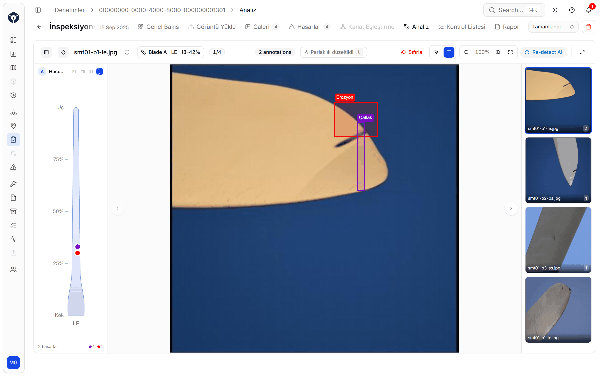

import { AccordionItem, Accordions, Badge, Callout, Steps } from '@prosefly/astro-components';
import Kbd from '@/components/Kbd.astro';

Annotation Studio, kanat fotoğrafı üzerinde hasar kutuları çizdiğiniz ve düzenlediğiniz çalışma ekranıdır. Denetim detayındaki **Analiz** sekmesi bu ekranı açar. AI ön taraması sonrasında inceleme modunda kullanıldığı gibi, tarama yapılmadan doğrudan elle işaretleme için de kullanılabilir.

Ekran dört bölgeden oluşur. Ortada kanat fotoğrafı, sağda seçili kutunun özelliklerini düzenlediğiniz panel, altta denetimdeki tüm kareleri gösteren film şeridi, üstte araç çubuğu bulunur. Sol taraftaki kanat haritası paneli ise görüntünün kanat üzerindeki konumunu gösterir.

Fotoğraf açılırken önce hızlı bir önizleme görünür, orijinal dosya arka planda yüklenir ve hazır olduğunda kendiliğinden devreye girer. Büyük dosyalarda bu birkaç saniye sürebilir; önizleme üzerinde çizim yapmaya başlayabilirsiniz.

## Kutu çizme

Elle hasar işaretlemek için birkaç adım yeterlidir. Kutu çizme yetkisi sahip, yönetici ve denetçi rollerine açıktır; operatör ve izleyici görüntüyü açabilir ama kutu çizemez.

<Steps>

1. **Çizim aracını seçin**

   Araç çubuğundan Dikdörtgen Çiz aracını etkinleştirin.

2. **Kutuyu çizin**

   Hasarın üzerine sürükleyin. Fareyi bıraktığınızda kutu kaydedilir.

3. **Tip ve şiddet verin**

   Sağ panelden hasar tipini ve şiddetini seçin. Bu bilgiler raporun içeriğini ve türbin sağlık skorunu belirler.

</Steps>

## Hasar tipleri

Sentark'ta beş sabit hasar tipi vardır ve her tipin kendi rengi bulunur. Renkler, fotoğraf üzerinde farklı hasarları ayırt etmeyi kolaylaştırır.

| Tip | Renk | Tipik görünüm |
|---|---|---|
| **Çatlak** | kırmızı | yapısal çatlak, kanat yüzeyinde çizgi biçimli ayrılma |
| **Erozyon** | turuncu | hücum kenarında aşınma ve malzeme kaybı |
| **Kaplama Hasarı** | sarı | boya veya kaplama soyulması |
| **Yıldırım Hasarı** | mor | receptor çevresinde yanma izi veya delaminasyon |
| **Yabancı Cisim** | camgöbeği | yüzeye yapışmış nesne veya kuş kalıntısı |

## Şiddet

Her hasar dört şiddet seviyesinden birini alır: <Badge variant="solid" color="danger">Kritik</Badge> <Badge variant="soft" color="warning">Ciddi</Badge> <Badge variant="subtle" color="neutral">Orta</Badge> <Badge variant="outline" color="neutral">Küçük</Badge>

AI ön tarama şiddeti önerir, ancak son karar sizindir. Şiddet seçimi iki yeri doğrudan etkiler: raporun önceliklendirme bölümü ve türbinin sağlık skoru. Kritik bir hasar skoru hızla düşürürken küçük bir hasarın etkisi sınırlıdır. Bu yüzden şiddeti aceleyle seçmemek, denetim sonuçlarının doğruluğu için önemlidir.

## Kutuyu düzenleme

Seç aracıyla bir kutuya tıkladığınızda kutu seçili duruma geçer. Sürükleyerek taşıyabilir, köşelerinden boyutlandırabilirsiniz. Sağ panelden sınıfı veya şiddeti değiştirebilirsiniz.

Bir AI kutusuna dokunduğunuzda kutunun kaynağı "AI (düzenlendi)" olarak işaretlenir. Kendi çizdiğiniz kutuların kaynağı "İnsan" olarak kalır. Bu ayrım, raporda ve analitik ekranlarında hangi bulguların AI tarafından önerildiğini ve hangilerinin elle eklendiğini gösterir.

Kutuyu silmek için seçiliyken <Kbd>Delete</Kbd> tuşuna basabilir veya paneldeki sil düğmesini kullanabilirsiniz. AI kutularında silme sırasında red nedeni sorulur; ayrıntısı [İnceleme](/inceleme/) sayfasında.

<Callout type="danger" title="Sıfırla işlemi geri alınamaz">
  Sağ paneldeki **Sıfırla** düğmesi, o karedeki tüm hasarları siler. Onay
  ister, ancak onayladıktan sonra geri alınamaz. Tek tek silmek her zaman daha
  güvenli yoldur.
</Callout>

## Klavye kısayolları

| Tuş | İş |
|---|---|
| <Kbd>Enter</Kbd> | İncelemede: Doğru kararı ver ve sonraki kareye geç |
| <Kbd>E</Kbd> | İncelemede: Düzenle |
| <Kbd>S</Kbd> | İncelemede: Geç |
| <Kbd>L</Kbd> | Parlaklık düzeltmesini aç veya kapat |
| <Kbd>Delete</Kbd> | Seçili kutuyu sil |
| <Kbd>1</Kbd> ile <Kbd>6</Kbd> | Silme diyaloğunda red nedeni seç, <Kbd>Esc</Kbd> vazgeç |
| Fare tekerleği | Yakınlaştır veya uzaklaştır |

## Kutunun konumu fotoğraftan gelir

Bir kutunun kanat üzerindeki konumu, kutunun fotoğraf içindeki piksel konumundan değil, fotoğrafın kanat, yüzey ve kapsam bilgisinden hesaplanır. Kutuyu fotoğraf içinde taşımak hasarın kanat üzerindeki konumunu değiştirmez. Kare yanlış kanada atanmışsa kutular da yanlış yerde görünür; bu durumda [Kanat ve yüzey eşleştirme](/kanat-eslestirme/) adımlarıyla atamayı düzeltin.

Sistem, aynı kanat ve yüzeyde birbirine yakın kapsamdaki anotasyonları tek hasarda birleştirir. Bu birleştirmenin nasıl çalıştığını [Hasarlar](/hasarlar/) sayfasında bulabilirsiniz.

## Sık sorulanlar

<Accordions>
  <AccordionItem title="Kutu çizemiyorum, neden?">
    İki olası neden var. Rolünüz operatör veya izleyici olabilir; bu roller
    kutu çizemez. Ya da görüntü henüz bir kanada atanmamıştır; atama olmadan
    kutu çizimi açılmaz.
  </AccordionItem>
  <AccordionItem title="Aynı hasar üç karede görünüyor, hepsini işaretlemeli miyim?">
    Evet. Her karedeki görünüm ayrı bir anotasyondur ve kendi başına
    kaydedilir. Sistem bu anotasyonları kapsam bilgisine göre tek hasarda
    birleştirir.
  </AccordionItem>
  <AccordionItem title="Karanlık fotoğrafta kutu doğru mu, emin değilim">
    L tuşuyla parlaklık düzeltmesini kapatıp kutuyu ham görüntüde kontrol
    edin. Düzeltme açıkken görünen bir ayrıntı, ham görüntüde hasar olmayabilir.
  </AccordionItem>
</Accordions>
