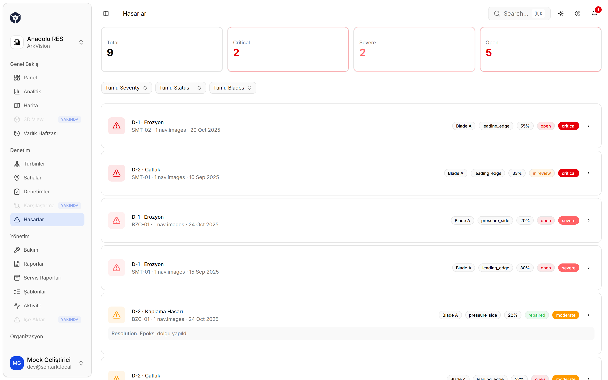

import { AccordionItem, Accordions, Callout } from '@prosefly/astro-components';

Hasarlar sayfası, organizasyonunuzdaki tüm fiziksel bulguların tek listesidir. Denetimlerde işaretlenen kutular burada birleştirilmiş halleriyle görünür. Bu sayfa rapor öncesi son gözden geçirme, bakım önceliklendirme ve filo geneli hasar takibi için kullanılır.

## Anotasyon ve hasar farkı

Sentark'ta iki kavram sık karıştırılır ve bu ayrımı anlamak listeyi doğru okumanın anahtarıdır.

**Anotasyon**, bir fotoğraf üzerine çizilen kutudur. Aynı hasar üç farklı açıdan fotoğraflandıysa üç ayrı anotasyon vardır. Anotasyonlar fotoğrafa bağlıdır ve fotoğraf silinirse onlar da silinir.

**Hasar**, kanattaki tek fiziksel bulgudur. Sistem, aynı kanat ve yüzeyde aynı tipte ve birbirine yakın kapsamda bulunan anotasyonları otomatik olarak tek hasarda birleştirir. Böylece listede aynı çatlağı üç kez değil, "üç karede görünen tek hasar" olarak görürsünüz. Her hasarın bir kodu vardır ve bu kod raporda referans olarak kullanılır.

<Callout type="note" title="Gruplama neden her zaman çalışmayabilir">
  Birleştirme kanat, yüzey, tip ve kapsam yakınlığına bakar. Karelerin kapsam
  bilgisi girilmemişse sistem hasarın kanat üzerindeki yerini bilemez ve
  birleştirme yapamaz. Bu durumda aynı hasar birden çok satırda görünebilir.
</Callout>

## Liste ve filtreler

Hasarlar sayfası her hasarı tek satırda gösterir. Satırda hasarın tipi, şiddeti, durumu, bağlı olduğu türbin ve denetim, kanadı, yüzeyi, kanat bölgesi yüzdesi, kaç karede göründüğü, kaynağı (AI, insan veya AI düzenlendi) ve AI güven skoru yer alır.

Sayfanın üstündeki özet kartlar toplam hasar sayısını, kritik ve ciddi hasarları ve açık durumdaki hasarları gösterir. Filtrelerle şiddete, duruma ve kanat konumuna göre süzme yapabilirsiniz. Bu filtreler özellikle bakım planlaması sırasında işe yarar: kritik şiddetteki açık hasarları listeleyip öncelik sırası oluşturabilirsiniz.

## Önceliklendirme

Bakım ekipleri genellikle önce kritik ve ciddi hasarlarla ilgilenir. Şiddet filtresiyle bu hasarları ayırdığınızda, hangi türbinlerde acil müdahale gerektiğini hızlıca görürsünüz. Kanat bölgesi yüzdesi de karar vermede yardımcıdır: kanat köküne yakın bir hasar, kanat ucuna yakın aynı şiddetteki bir hasardan genellikle daha kritiktir.

Durum filtresi ise işin tamamlanma durumunu izler. Açık hasarlar henüz kapatılmamış bulgulardır; takipteki hasarlar için bakım görevi açılmış ama iş bitmemiştir; kapatıldı durumundaki hasarlar onarılmış veya artık risk taşımadığı kabul edilmiş bulgulardır.

## Durum güncelleme

Hasarın yaşam durumunu sahip, yönetici ve denetçi rolleri güncelleyebilir. Durum güncellemesi, bakım süreciyle birlikte yürür: bir hasar için [Bakım Takibi](/bakim/) sayfasından görev açarsınız, iş tamamlandığında hasarın durumunu kapatıldı yaparsınız. Bu iki kaydın birlikte güncel tutulması, raporlardaki "açık hasar" sayılarının ve türbin sağlık skorunun doğru kalmasını sağlar.

Kanıta inmek için satırdaki hasara tıklayın. İlgili denetime ve karelere giderek anotasyonu Studio'da görebilirsiniz. Bu, bir hasarın gerçekten var olup olmadığını tartışırken en sağlıklı yoldur.

## Sık sorulanlar

<Accordions>
  <AccordionItem title="Aynı hasar listede iki kez görünüyor, neden?">
    Gruplama kanat, yüzey, tip ve kapsam yakınlığına bakar. Karelerin kapsam
    bilgisi eksikse veya kareler farklı yüzeylere atanmışsa birleştirme
    yapılamaz. Kanat ve yüzey atamalarını kontrol edip eksik kapsamları
    tamamladığınızda sistem gruplamayı yeniden hesaplar.
  </AccordionItem>
  <AccordionItem title="AI güven skoru düşük bir hasar ne demek?">
    Düşük güven skoru, modelin bu kutudan emin olmadığını gösterir. Hasarı
    silmek yerine Studio'da açıp kendiniz değerlendirin. Gerçekten yanlışsa
    silerken neden belirtmeniz modellerin iyileşmesine katkı sağlar.
  </AccordionItem>
  <AccordionItem title="Bir hasarı sildim, geri alabilir miyim?">
    Silinen hasarlar geri alınamaz. Ancak hasar bir AI kutusundan geldiyse
    ilgili görüntüyü yeniden incelemeye açıp aynı bulguyu tekrar
    işaretleyebilirsiniz. Aktivite günlüğünde silme işleminin kaydı tutulur.
  </AccordionItem>
</Accordions>
