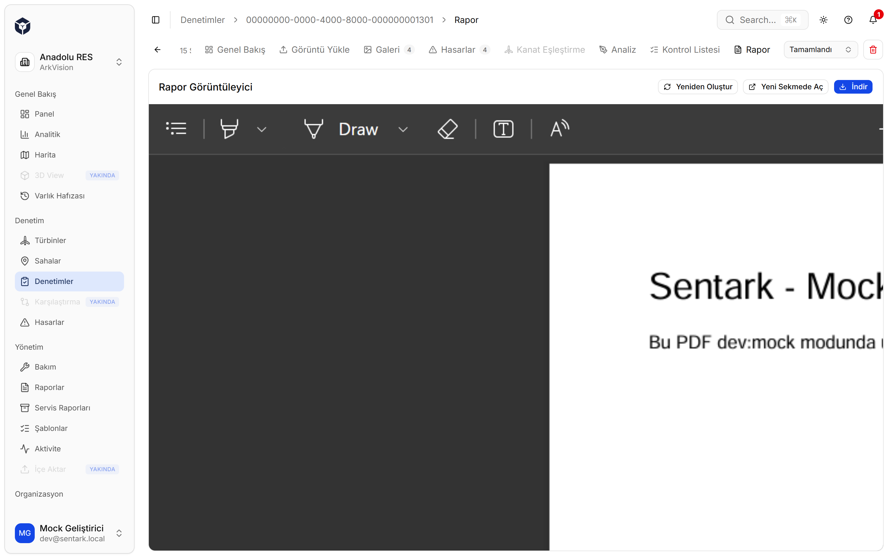
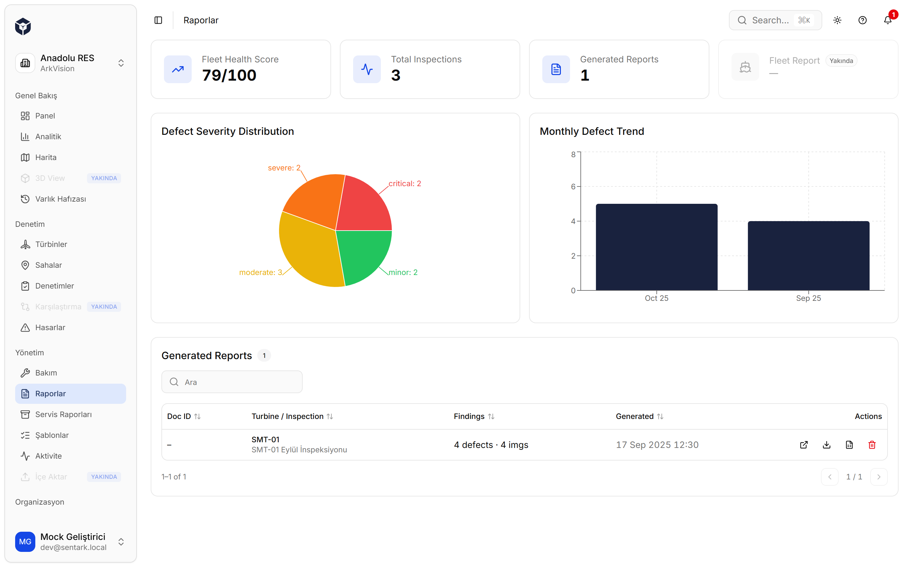
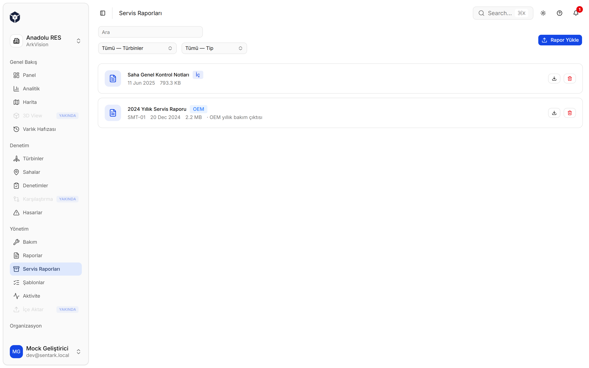

import { AccordionItem, Accordions, Callout, Card, CardGrid, Steps } from '@prosefly/astro-components';

Rapor, bir denetimin son ürünüdür. Tüm görüntüleme, işaretleme ve inceleme çalışması sonunda imzalı bir PDF'e dönüşür ve müşteriye, yönetime veya bakım ekibine sunulur. Sentark'ta "rapor" adı altında birkaç farklı ekran bulunduğu için önce hangi raporla çalıştığınızı netleştirmek gerekir.

<CardGrid>
  <Card icon="lucide:file-badge" title="Resmi denetim raporu">
    Bir denetimin imzalı PDF çıktısıdır. Denetimin Rapor sekmesinde üretilir ve bu sayfanın ana konusudur.
  </Card>
  <Card icon="lucide:chart-pie" title="Raporlar sayfası">
    Filo geneli grafikleri PDF veya CSV olarak dışa aktaran analiz ekranıdır.
  </Card>
  <Card icon="lucide:archive" title="Servis raporları">
    OEM ve üçüncü taraf raporlarının dosya arşividir. Denetimle ilişkisi yoktur.
  </Card>
  <Card icon="lucide:list-checks" title="Şablonlar">
    Denetimlere eklenen kontrol listeleridir. Ayrı bir sayfada anlatılır.
  </Card>
</CardGrid>

## Resmi rapor üretimi

Resmi rapor üretimi sahip, yönetici ve denetçi rollerine açıktır. Üretim sunucuda yapılır ve denetimdeki tüm görüntüler, hasarlar, kontrol listesi ve çekim bilgileri tek bir PDF'te toplanır.

<Steps>

1. **Rapor sekmesini açın**

   Denetim detay sayfasında Rapor sekmesine geçin.

2. **Üretimi başlatın**

   "Rapor Oluştur" düğmesine basın. Üretim başlar ve ekranda "Rapor oluşturuluyor" mesajı görünür.

3. **Üretimin bitmesini bekleyin**

   Üretim birkaç dakika sürebilir. Bu sırada sayfadan ayrılmayın; ayrılırsanız üretim devam eder ama sonucu görmek için sayfaya geri dönmeniz gerekir.

4. **PDF'i indirin**

   Üretim tamamlandığında PDF sayfa içindeki görüntüleyicide açılır. İndir veya Yeni Sekmede Aç düğmeleriyle dosyayı alabilirsiniz.

</Steps>

Üretilen rapor kalıcıdır. Denetim sayfasına günler sonra döndüğünüzde rapor yerinde durur ve indirilebilir. Denetimde değişiklik yaptıysanız, örneğin inceleme sonrası bir hasarı güncellediyseniz, güncel veriyle yeni bir PDF almak için **"Yeniden Oluştur"** düğmesini kullanın. Yeniden oluşturma önceki dosyanın üzerine yazar.

## Üretim kilitleri

Rapor üretimi, denetimin durumuna bağlı olarak kilitlenebilir. AI taraması sürerken düğme pasiftir ve "AI ön tarama sürerken rapor oluşturulamaz" mesajı görünür. Taramanın bitmesini beklemek gerekir.

İnceleme bitmediyse düğme açıktır ama bir uyarı çıkar: "inceleme henüz bitmedi, rapor eksik hasar içerebilir". Bu uyarı ciddiye alınmalıdır. Onaylanmamış AI kutuları rapora girmez, dolayısıyla rapor olduğundan az hasar gösterebilir. Mümkünse önce [incelemeyi](/inceleme/) bitirin, sonra raporu üretin.

<Callout type="note" title="Üretilmiş rapor görüntüsü">
  📷 Üretilen rapor, sayfa içi PDF görüntüleyicide kapak sayfasıyla açılır.
  Gerçek rapor çıktısının görüntüsü canlı ortamdan eklenecek.
</Callout>

## Raporlar sayfası

Kenar çubuğundaki **Raporlar** sayfası, tek bir denetimin değil filo genelinin raporudur. Hasar trendleri, şiddet dağılımı ve durum özetleri grafikler halinde sunulur. Bu grafikleri PDF veya CSV olarak dışa aktarabilirsiniz. PDF, yönetim sunumları için; CSV ise kendi analizleriniz için uygundur.

## Servis raporları

Servis raporları, denetim dışında kalan belgelerin arşividir. OEM firmasının gönderdiği inceleme raporları, üçüncü taraf denetim firmalarının çıktıları veya iç notlar buraya yüklenir. **"Rapor Yükle"** düğmesiyle PDF veya docx dosyası bırakırsınız, başlık ve kaynak türü (İç veya 3. Taraf) etiketlersiniz.

Bu arşiv, bir türbinin geçmişine bakarken Sentark dışında üretilmiş belgeleri de aynı yerde tutmanızı sağlar. Listeden dosyaları indirebilir veya silebilirsiniz.

## Sık sorulanlar

<Accordions>
  <AccordionItem title="Rapor neden eksik hasarlı çıktı?">
    En yaygın neden, incelemenin tamamlanmamış olmasıdır. Onaylanmayan AI
    kutuları rapora yansımaz. İncelemeyi bitirip raporu Yeniden Oluştur ile
    güncelleyin.
  </AccordionItem>
  <AccordionItem title="Eski bir raporu geri alabilir miyim?">
    Raporlar her zaman yeniden üretilebilir. Silinen raporlar geri dönmez,
    ancak denetim kaydı duruyorsa aynı raporu yeniden oluşturabilirsiniz.
    Silme geçmişi sistemde tutulur; gerekirse yöneticiniz destek kanalından
    geri açtırabilir.
  </AccordionItem>
  <AccordionItem title="Rapor üretimi neden uzun sürüyor?">
    Üretim, denetimdeki tüm görüntüleri işleyip PDF'e yerleştirir. Görüntü
    sayısı arttıkça süre uzar. Yüzlerce görüntülük denetimlerde birkaç dakika
    normaldir.
  </AccordionItem>
</Accordions>
