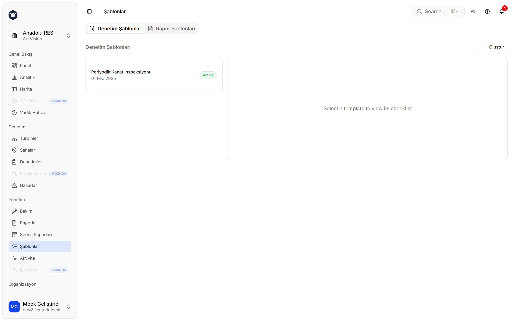

import { Callout, Steps } from '@prosefly/astro-components';

Şablon, bir denetimde kontrol edilmesi gereken maddelerin önceden tanımlanmış listesidir. Her denetimde aynı kontrolleri sıfırdan düşünmek yerine, sahada tekrar eden işleri bir şablona bağlarsınız. Denetim oluştururken bu şablonu seçtiğinizde kontrol listesi denetime kendiliğinden eklenir ve saha çalışması sırasında madde madde işaretlenir.

Şablonlar, denetim kalitesinin ekipten ekibe değişmesini engeller. Deneyimli bir denetçinin aklında tuttuğu kontrol sırası, şablon sayesinde yeni ekipler için de standart hale gelir. Ayrıca rapor üretildiğinde kontrol listesinin tamamlanma durumu rapora eklenir, böylece hangi kontrollerin yapıldığı belgelenmiş olur.

## Şablon oluşturma

Şablon yönetimi sahip ve yönetici rollerine açıktır. **Şablonlar** sayfasındaki **Denetim Şablonları** bölümünde mevcut şablonları görür ve yenilerini ekleyebilirsiniz.

<Steps>

1. **Yeni şablon formunu açın**

   Kenar çubuğundan Şablonlar sayfasına gidin ve "Yeni Şablon" düğmesine basın.

2. **Şablona ad verin**

   Örneğin "Periyodik Kanat İnspeksiyonu" gibi, hangi işi kapsadığını anlatan bir ad seçin.

3. **Kontrol maddelerini ekleyin**

   Her madde kısa ve tek bir işi anlatan bir cümle olmalı: "Kanat kökü civatalarını kontrol et", "Hücum kenarında erozyon ara", "Receptor çevresinde yanma izi kontrol et" gibi.

4. **Kaydedin**

   Şablon, denetim oluşturma sihirbazındaki şablon listesinde görünmeye başlar.

</Steps>

## Şablonun denetime eklenmesi

Denetim oluştururken **Şablon** alanından bir şablon seçerseniz, o şablonun maddeleri denetimin **Kontrol Listesi** sekmesine eklenir. Şablon seçmezseniz bu sekme görünmez; yani kontrol listesi isteğe bağlı bir özelliktir.

Saha çalışması sırasında her madde işaretlenir. İşaretleme durumu denetimle birlikte saklandığı için iş yarıda kalsa bile nerede kaldığınızı görürsünüz. Raporda kontrol listesinin hangi maddelerinin tamamlandığı listelenir.

<Callout type="tip" title="İyi şablon yazmanın kısa kuralı">
  Her madde tek bir kontrolü anlatmalı ve sahadaki bir eyleme karşılık
  gelmelidir. "Kanadı incele" gibi genel ifadeler yerine, neyin nasıl
  kontrol edileceğini söyleyen maddeler yazın.
</Callout>

## Şablonları güncelleme

Bir şablonu güncellediğinizde, şablonu kullanan geçmiş denetimler etkilenmez. Her denetim oluşturulduğu andaki kontrol listesini taşır. Bu davranış, geçmiş raporların sonradan değişmemesi için gereklidir. Şablon değişikliği yalnızca bundan sonra oluşturulacak denetimlerde görünür.

Kullanılmayan şablonları silebilirsiniz. Silme işlemi, şablonu kullanmış geçmiş denetimleri etkilemez.
