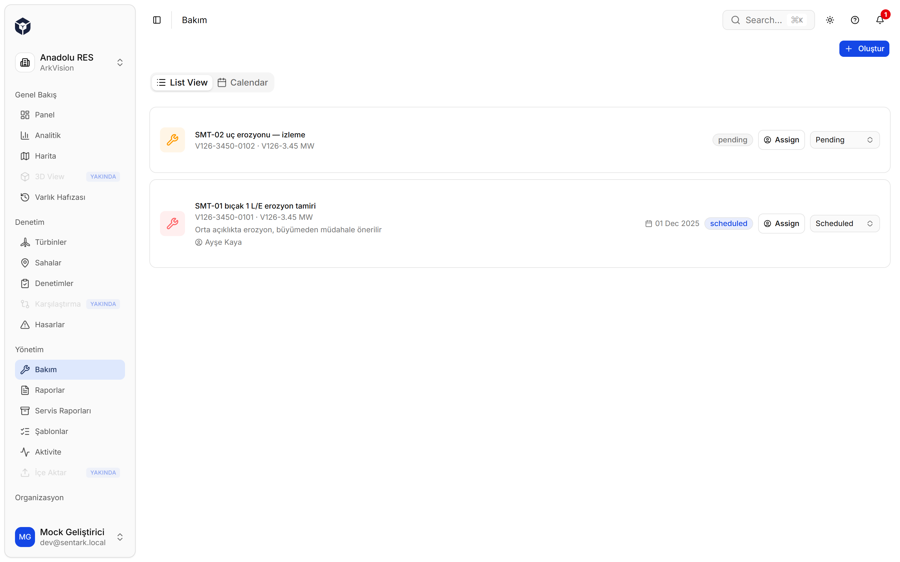

import { Callout, Steps } from '@prosefly/astro-components';

Bir denetim hasar tespit ettiğinde iş bitmez. Hasarın onarılması, ertelenmesi veya risk kabulüyle kapatılması gerekir. Bakım sayfası, bu kararları ve işleri takip ettiğiniz iş emri panosudur. "Bu çatlağı kim, ne zaman, hangi öncelikle onaracak?" sorusunun cevabı burada yaşar.

Bakım görevleri hasarlardan bağımsız da oluşturulabilir; örneğin planlı periyodik bakımlar bir hasara bağlı olmayabilir. Ancak en yaygın kullanım, kritik bir bulgudan doğan onarım işini takip etmektir.

## Görev oluşturma

Görev oluşturma ve düzenleme sahip, yönetici ve denetçi rollerine açıktır. Görüntüleme herkese açıktır, böylece bakım ekibi de panoyu takip edebilir.

<Steps>

1. **Görev formunu açın**

   Kenar çubuğundan Bakım sayfasına gidin ve "Yeni Bakım Görevi" düğmesine basın.

2. **Türbinü ve ilgili kaydı seçin**

   Görev, hasar veya denetimle ilişkilendirilecekse ilgili kaydı da bağlayın.

3. **İş tanımını yazın**

   Örneğin "K1 hücum kenarındaki erozyon bölgesinin onarımı" gibi, işi yapacak ekibin anlayacağı bir açıklama girin.

4. **Önceliği ve tarihi belirleyin**

   Öncelik, panoda sıralamayı ve görünürlüğü etkiler. Planlanan tarih takvim görünümüne yansır.

5. **Kaydedin**

   Görev listeye ve takvime düşer.

</Steps>

## Liste ve takvim görünümü

Bakım sayfası iki görünüm arasında geçiş yapar. Liste görünümü tüm görevleri durum ve tarih sırasıyla tablo halinde gösterir. Takvim görünümü ise görevleri planlanan tarihlerine yerleştirir ve yaklaşan işleri haftalık veya aylık olarak görmenizi sağlar.

Planlı bakımlar ve acil müdahaleler aynı panoda birikir. Takvim görünümü özellikle ekip planlaması için kullanışlıdır: aynı haftaya düşen işleri görüp saha ziyaretlerini birleştirebilirsiniz.

## Hasar durumuyla ilişkisi

Bakım görevi kapandığında ilgili hasarın durumu otomatik olarak değişmez. Hasarı da [Hasarlar](/hasarlar/) sayfasından kapatıldı durumuna getirmeniz gerekir. Bu iki adımı birlikte yapmak, raporlardaki açık hasar sayılarının ve türbin sağlık skorunun doğru kalmasını sağlar.

<Callout type="warning" title="Görevi kapatırken hasarı da güncelleyin">
  Yalnızca bakım görevini kapatmak, hasarı açık durumda bırakır. Bu durumda
  raporlar hâlâ açık hasar gösterir ve sağlık skoru düşük kalır. İki kaydı
  birlikte güncellemek raporlama tutarlılığı için önemlidir.
</Callout>

## Bakım geçmişinin değeri

Bir türbinin bakım geçmişi, gelecekteki kararların en sağlam dayanağıdır. Aynı bölgede tekrar eden onarımlar, malzeme veya çekim kalitesiyle ilgili bir soruna işaret edebilir. [Varlık Hafızası](/harita-varlik-hafizasi/) ekranı, türbinin denetim ve bakım geçmişini bir arada göstererek bu tür örüntüleri görmenizi kolaylaştırır.
