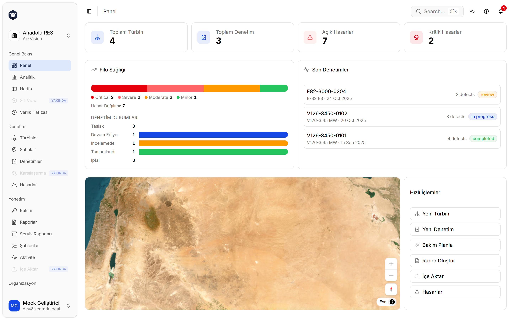

import { Callout } from '@prosefly/astro-components';

Panel, giriş yaptığınızda açılan ekrandır ve filonuzun o günkü durumunu tek bakışta özetler. Sabah işe başladığınızda ilk açacağınız yer burasıdır: hangi denetimler devam ediyor, kaç açık hasar var, kritik durumda türbin var mı, hepsini burada görürsünüz.

## Filo sayaçları

Ekranın üst kısmında dört sayaç bulunur. **Toplam Türbin** filonuzdaki kayıtlı türbin sayısını gösterir. **Toplam Denetim** bugüne kadar oluşturulmuş denetimlerin toplamıdır. **Açık Hasarlar** durumu henüz kapatılmamış hasarları sayar. **Kritik Hasarlar** ise şiddeti kritik olan hasarları gösterir.

Bu dört sayı, organizasyonunuzun genel sağlığını anlatan en kısa özettir. Açık hasar sayısının zamanla artması, bakım süreçlerinin geriden geldiğine işaret edebilir. Kritik hasar sayısındaki ani artış ise yeni bir denetimde ciddi bulgular bulunduğunu gösterir.

## Filo haritası

Sayaçların altında filo haritası yer alır. Konumu girilmiş türbinler harita üzerinde sağlık skorlarına göre renklenmiş işaretçilerle görünür. Yeşil işaretçi sağlıklı türbini, sarı uyarı seviyesindeki türbini, kırmızı ise kritik durumdaki türbini gösterir. Bir işaretçiye tıkladığınızda türbinin detay sayfası açılır.

Haritada boş görünen bölgeler ya türbin konumlarının girilmediğini ya da o bölgede kayıtlı türbin olmadığını gösterir. Konum bilgisini [Türbinler](/turbinler/) sayfasından tamamlayabilirsiniz.

## Son denetimler ve şiddet dağılımı

Panelin alt kısmında son ve devam eden denetimler listelenir. Her satırda denetim başlığı, türbin, durum ve görüntü sayısı görünür. İncelemede durumundaki denetimler, sizin veya ekibinizin onayını bekleyen işlerdir; bu listeye düzenli bakmak, bekleyen işlerin gözden kaçmasını engeller.

Şiddet dağılımı grafiği, açık hasarların şiddet seviyelerine göre dağılımını gösterir. Kritik dilimin büyük olması, acil bakım ihtiyacına işaret eder.

## Hızlı işlemler

Panelde sık kullanılan işlemlere kısayollar bulunur: yeni türbin ekleme, yeni denetim açma, bakım planlama ve rapor oluşturma. Bu düğmeler ilgili formu doğrudan açar; menülerde gezinmenize gerek kalmaz.

<Callout type="tip" title="Günlük kontrol alışkanlığı">
  Güne panelden başlamak ve üç şeye bakmak yeterlidir: kritik hasar sayısı,
  incelemede bekleyen denetimler ve son denetimler listesi. Bu üç bilgi
  günün işini büyük ölçüde belirler.
</Callout>

## Boş panel

Yeni bir organizasyonda tüm sayaçlar sıfır görünür ve harita boştur. Bu normaldir. İlk saha, türbin ve denetim oluşturulduğunda panel dolmaya başlar. Veri biriktikçe panel, filonuzun nabzını tutan bir ekrana dönüşür.
