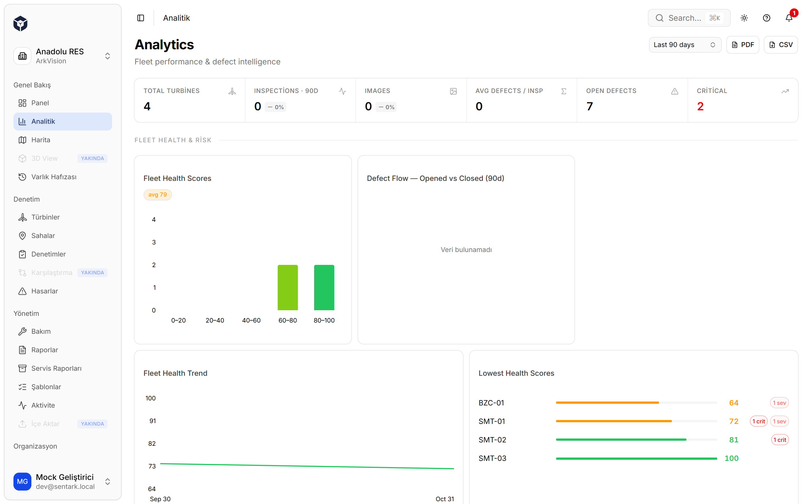

import { Callout } from '@prosefly/astro-components';

Analitik sayfası, filonuzun verisini grafiklerle derinlemesine incelemenizi sağlar. Panel günlük özeti verirken analitik, zaman içindeki eğilimleri ve örüntüleri ortaya çıkarır. Bakım stratejisi belirlemek, belirli bir kanat bölgesinde tekrar eden hasarları görmek veya denetim operasyonlarının verimliliğini ölçmek için bu sayfayı kullanırsınız.

Sayfa veri yoğun olduğu için üst kısımdaki filtrelerle başlamak en doğrusudur. Zaman aralığı ve kapsam filtreleri sayfadaki tüm grafikleri birlikte etkiler; dar bir döneme odaklandığınızda grafikler o dönemin verisini gösterir.

## Hasar trendleri

Trend grafikleri, hasar sayılarının zaman içinde nasıl değiştiğini gösterir. Bu grafikler iki soruya cevap verir: filo genelinde hasar sayısı artıyor mu, azalıyor mu ve belirli bir hasar tipi diğerlerinden daha hızlı mı büyüyor?

Örneğin hücum kenarı erozyonunun yaz aylarında artması, belirli bir bölgedeki türbinlerde çekim kalitesinin düşmesi veya bakım sonrası hasar sayısının azalması gibi örüntüler bu grafiklerde görünür hale gelir. Trendleri yorumlarken denetim sayısını da hesaba katmak gerekir: daha çok denetim yapılan bir dönemde daha çok hasar bulunması doğaldır.

## Kanat konum dağılımı

Kanat konum dağılımı, hasarların kanat boyunca hangi bölgelerde yoğunlaştığını gösterir. Kanat köküne yakın hasarlar genellikle daha kritik kabul edilir; kanat ucu bölgesindeki hasarlar ise çoğunlukla yıldırım kaynaklıdır.

Bu dağılım, çekim stratejisini de bilgilendirir. Belirli bir bölgede sürekli hasar çıkıyorsa, o bölgenin daha sık ve daha yakından fotoğraflanması gerekebilir. Aynı bilgi, yedek parça ve onarım planlaması için de girdi oluşturur.

## Denetim operasyonları

Operasyon grafikleri denetim süreçlerinin verimliliğini ölçer. Kaç denetim açıldı, kaçı tamamlandı, inceleme aşamasında ne kadar süre geçti gibi metrikler burada yer alır. Uzun süre incelemede bekleyen denetimler, ekip kapasitesi veya iş akışıyla ilgili bir darboğaza işaret eder.

## Ekip ve kalite metrikleri

Sayfada ekip performansını gösteren metrikler de bulunur. Hangi kullanıcı kaç denetim tamamladı, incelemelerde ne kadar kutu düzeltildi veya silindi gibi bilgiler, süreç kalitesini izlemenizi sağlar. Silinen AI kutularının oranı yüksekse, çekim kalitesi veya model eşikleri gözden geçirilmelidir.

<Callout type="tip" title="Filtrelerden başlayın">
  Analitik ekranındaki tüm grafikler üst filtrelerle birlikte hareket eder.
  Önce zaman aralığını daraltıp sonra grafikleri okumak, geniş bir dönemin
  gürültüsünde kaybolmayı önler.
</Callout>

## Veri biriktikçe değerlenir

Analitik ekranının anlamlı hale gelmesi için yeterli denetim geçmişi gerekir. Yeni bir organizasyonda grafikler boş görünebilir. Birkaç denetim döneminden sonra trendler okunabilir hale gelir ve karar destek için kullanılabilir.
