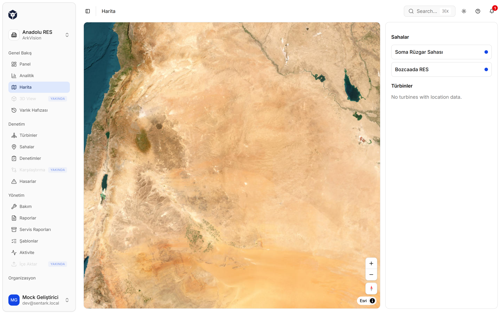
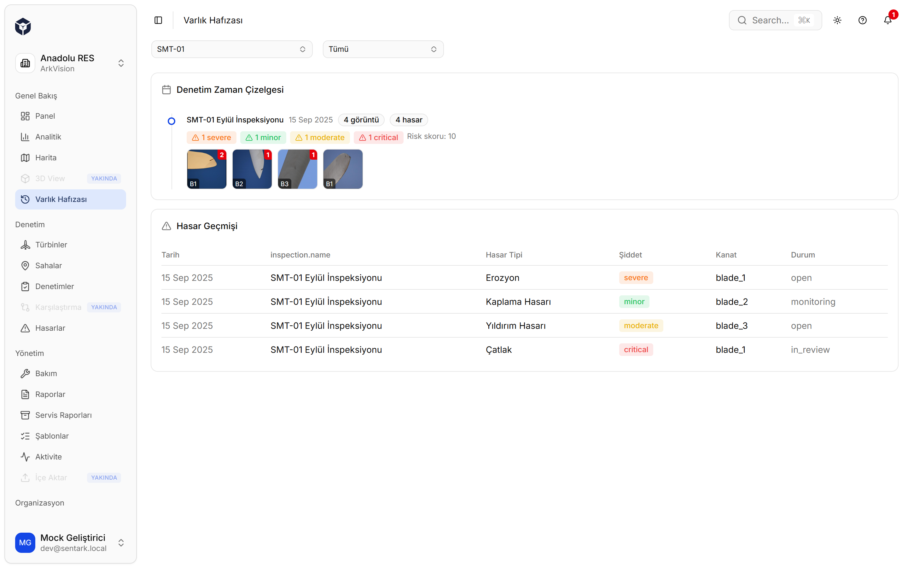

import { Callout } from '@prosefly/astro-components';

Filo haritası ve varlık hafızası, aynı veriye iki farklı açıdan bakar. Harita, filonuzu coğrafi olarak gösterir ve bölgeler arasında karşılaştırma yapmanızı sağlar. Varlık hafızası ise tek bir türbine odaklanır ve o türbinin yıllar içindeki hikâyesini anlatır. İkisi birlikte, hem "nerede sorun var" hem de "bu sorun nasıl gelişti" sorularına cevap verir.

## Filo haritası

Harita sayfası, konumu girilmiş tüm türbinleri tek bir harita üzerinde gösterir. Her türbin bir işaretçiyle temsil edilir ve işaretçinin rengi türbinin sağlık skorunu yansıtır.

| Renk | Anlam |
|---|---|
| Yeşil | Sağlıklı, skor 80 ve üzeri |
| Sarı | Uyarı, skor 50 ile 79 arası |
| Kırmızı | Kritik, skor 50'nin altı |

İşaretçiye tıkladığınızda türbinin detay sayfası açılır. Harita üzerinde bölge bazında yoğunlaşan kırmızı işaretçiler, o bölgede sistematik bir sorun olduğuna işaret edebilir: aynı rüzgar rejimine maruz kalan türbinler benzer hasarlar geliştirebilir.

<Callout type="note">
  Konumu girilmemiş türbinler haritada görünmez. Türbin kaydına konum
  eklemek için <a href="/turbinler/">Türbinler</a> sayfasındaki adımları
  izleyin.
</Callout>

## Varlık hafızası

Varlık hafızası ekranı tek bir türbine odaklanır ve o türbinin tüm geçmişini bir arada gösterir. Denetim zaman çizelgesi hangi tarihte kaç görüntüyle denetim yapıldığını ve kaç hasar bulunduğunu listeler. Hasar geçmişi, tespit edilen hasarların zaman içindeki seyrini gösterir. Risk skoru ise türbinin mevcut durumunu tek bir sayıya indirger.

Bu ekran, "bu türbinin hücum kenarı erozyonu son üç denetimde nasıl seyretti?" gibi soruların cevabını verir. Aynı hasarın tekrar tekrar tespit edilmesi, onarımın kalıcı olmadığını veya kök nedenin giderilmediğini gösterebilir. Bakım kararları ve rapor öncesi durum değerlendirmesi için en sağlam veri kaynağıdır.

## İki ekranı birlikte kullanmak

Pratik bir akış şöyle olabilir: haritada kırmızı işaretçileri görüp hangi türbinlerin kritik durumda olduğunu belirlersiniz. Ardından bu türbinlerin varlık hafızasını açıp hasarların ne zamandır biriktiğini ve hangi kanatta yoğunlaştığını incelersiniz. Son olarak bakım planlaması için gerekli öncelikleri çıkarırsınız.

Bu kombinasyon, tek tek denetimlere bakarak görülemeyecek örüntüleri ortaya çıkarır. Özellikle büyük filolarda, hangi türbinlere önce müdahale edilmesi gerektiğine karar vermek için en hızlı yoldur.
