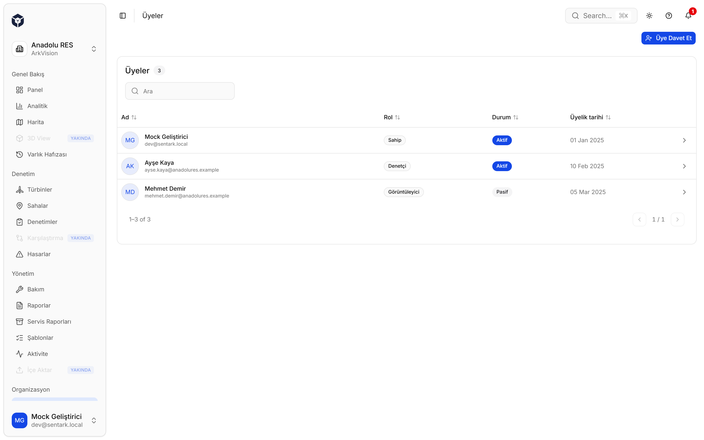

import { Callout, Steps } from '@prosefly/astro-components';

Üyeler sayfası, organizasyonunuza kimin erişebileceğini ve hangi rolde çalışacağını yönettiğiniz ekrandır. Üye davet etmek, rol değiştirmek ve pasife almak bu sayfadan yapılır. Bu işlemler sahip ve yönetici rollerine açıktır.

## Üye davet etme

Yeni bir kullanıcıyı sisteme eklemek için davet akışını kullanırsınız. Sistem, davet edilen kişi için bir hesap oluşturur ve size geçici bir şifre gösterir. Bu şifreyi üyeye iletmeniz gerekir; sistem otomatik e-posta göndermez.

<Steps>

1. **Davet formunu açın**

   Üyeler sayfasındaki "Üye Davet Et" düğmesine basın.

2. **E-posta ve rolü girin**

   Üyenin e-posta adresini ve rolünü seçin. İsim alanı isteğe bağlıdır.

3. **Hesabı oluşturun**

   Kaydettiğinizde sistem hesabı oluşturur ve ekranda e-posta ile geçici şifreyi gösterir.

4. **Bilgileri üyeye iletin**

   Kopyala düğmesiyle hazır metni alıp üyeye iletin. Metin, e-posta adresini ve geçici şifreyi içerir.

5. **İlk girişte şifre belirlenir**

   Üye ilk girişinde kendi şifresini belirler. Geçici şifre bu andan itibaren geçersiz olur.

</Steps>

<Callout type="tip" title="Geçici şifre tek seferliktir">
  Geçici şifreyi güvenli bir kanaldan iletin. Üye şifresini belirledikten
  sonra bu şifre çalışmaz. Şifreyi kaybederseniz üyeye yeni bir geçici şifre
  üretebilirsiniz.
</Callout>

## Rol atama ve değiştirme

Her üye bir rolle başlar ve rolü sonradan değiştirilebilir. Rol değişikliği anında etkili olur; kullanıcı bir sonraki sayfa yenilemesinde yeni yetkileriyle çalışır. Rolü düşürülen bir kullanıcı, artık yetkisi olmayan işlemlerin düğmelerini görmez.

Rolleri belirlerken en az yetki ilkesini izlemek iyi bir alışkanlıktır. Sahada yalnızca görüntü toplayan bir kullanıcıya operatör rolü yeterlidir; hasar işaretleme ve rapor üretme gibi işleri yapacak kişilere denetçi rolü verilmelidir. Yönetici rolü, organizasyon ayarlarına ve üye yönetimine erişim gerektiren kişiler için ayrılmalıdır.

## Üye işlemleri

Bir üyenin satırına tıkladığınızda detay paneli açılır. Bu panelde üyenin genel bilgileri ve aktivitesi görünür. İşlemler menüsünden şu adımları yapabilirsiniz.

**Rol değiştir** ile üyenin rolünü güncellersiniz. **Pasif Et** üyenin oturumunu kapatır ve sonraki girişlerini engeller; geçmiş kayıtları korunur. **Aktif Et** pasif üyeyi yeniden açar. **Şifre Sıfırla** üye için yeni bir geçici şifre üretir; üye sonraki girişte şifresini belirler. **Üyeyi Kaldır** üyeyi organizasyondan tamamen çıkarır ve bu işlem geri alınamaz.

<Callout type="danger" title="Üyeyi kaldırmak geri alınamaz">
  Ayrılan bir çalışan için pasife alma neredeyse her zaman daha uygun
  seçenektir. Pasif üye geri açılabilir ve geçmiş kayıtları bozulmaz. Üyeyi
  kaldırma yalnızca kalıcı ayrılıklarda kullanılmalıdır.
</Callout>

## Yetki tablosu

| Yetki | Sahip | Yönetici | Denetçi | Operatör | İzleyici |
|---|:---:|:---:|:---:|:---:|:---:|
| Organizasyonu silme | ✓ | | | | |
| Üye yönetimi | ✓ | ✓ | | | |
| Saha oluşturma ve silme | ✓ | ✓ | | | |
| Türbin oluşturma ve düzenleme | ✓ | ✓ | ✓ | | |
| Denetim oluşturma | ✓ | ✓ | ✓ | ✓ | |
| Görüntü yükleme | ✓ | ✓ | ✓ | ✓ | |
| Anotasyon çizme ve düzenleme | ✓ | ✓ | ✓ | | |
| AI taraması başlatma | ✓ | ✓ | ✓ | | |
| Hasar durumu güncelleme | ✓ | ✓ | ✓ | | |
| Rapor oluşturma | ✓ | ✓ | ✓ | | |
| Rapor indirme | ✓ | ✓ | ✓ | ✓ | ✓ |
| Bakım görevi yönetme | ✓ | ✓ | | | |
| Şablon yönetme | ✓ | ✓ | | | |
| Görüntüleme | ✓ | ✓ | ✓ | ✓ | ✓ |

Rol kavramlarının ayrıntılı anlatımı için [Organizasyon ve roller](/organizasyon-ve-roller/) sayfasına bakabilirsiniz.
