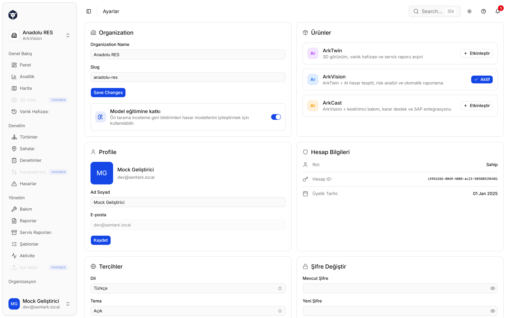

import { Callout } from '@prosefly/astro-components';

Ayarlar sayfası, hesabınız ve organizasyonunuzla ilgili kişisel ve idari tercihleri toplar. Sayfa birkaç bölümden oluşur ve her bölüm farklı bir sorumluluğa aittir. Profil ve güvenlik ayarları tüm kullanıcılara açıktır; organizasyon ayarları yalnızca sahip ve yönetici rollerine görünür.

## Profil

Profil bölümünde ad soyadınızı görüntüleyip düzenleyebilirsiniz. Hesap bilgileri arasında rolünüz ve üyelik tarihiniz de gösterilir. Bu bilgiler salt okunurdur; rol değişikliği yalnızca organizasyon yöneticisi tarafından yapılabilir.

## Şifre değiştirme

Şifre değiştirmek için mevcut şifrenizi ve yeni şifrenizi girmeniz gerekir. Yeni şifre en az altı karakter olmalıdır. Şifrenizi düzenli aralıklarla değiştirmek ve aynı şifreyi başka platformlarda kullanmamak temel güvenlik alışkanlıklarıdır.

Şifrenizi tamamen unuttuysanız bu ekran işinize yaramaz; bu durumda organizasyon yöneticinizden geçici şifre üretmesini istemeniz gerekir. Akışın ayrıntısı [Üyeler ve roller](/uyeler-roller/) sayfasında anlatılır.

## Aktif oturumlar

Aktif oturumlar bölümü, hesabınızın açık olduğu cihazları listeler. Bir cihazı tanımıyorsanız veya hesabınıza yetkisiz erişim şüphesi varsa **"Tüm Cihazlardan Çıkış"** düğmesiyle her yerdeki oturumları kapatabilirsiniz. Bu işlemden sonra tüm cihazlarda yeniden giriş yapmanız gerekir.

## Dil ve tema tercihleri

Arayüz dili Türkçe ve İngilizce arasında seçilebilir. Tema tercihi açık, koyu veya sistem olarak ayarlanır. Sistem seçeneği, işletim sisteminizin temasını izler ve gün içinde otomatik olarak değişir. Tema seçimi tarayıcınızda saklanır ve sonraki girişlerinizde korunur.

## Organizasyon ayarları

Organizasyon bölümünde organizasyonun adını ve aktif ürün modüllerini görürsünüz. Ürün modülleri, hangi menülerin ve özelliklerin kullanılabilir olduğunu belirler. Bir modül kapalıysa ona ait menüler görünmez. Bu ayarlar abonelik durumunuza bağlıdır ve yalnızca sahip ile yönetici tarafından görüntülenebilir.

## Model eğitimine katkı

Bu ayar, ön tarama incelemelerinizdeki geri bildirimlerin hasar modellerinin iyileştirilmesinde kullanılıp kullanılmayacağını belirler. Açık olduğunda, inceleme sırasında onayladığınız, düzelttiğiniz ve sildiğiniz kutular ile seçtiğiniz red nedenleri eğitim verisine dahil edilebilir. Kapalı olduğunda verileriniz eğitim ihracına girmez.

<Callout type="note" title="Bu ayar ne işe yarar">
  Modeller, gerçek denetimlerde verilen geri bildirimlerle iyileşir. Katkı
  açık olduğunda sizin düzeltmeleriniz modellerin gelecekte daha az yanılmasına
  yardımcı olur. Kapalı tutmak, verilerinizin eğitimde kullanılmamasını
  garanti eder.
</Callout>

## Tercihlerinizi nerede bulacaksınız

Ayarlar sayfasındaki bölümler rolünüze göre görünür veya gizlenir. Organizasyon ayarlarını göremiyorsanız rolünüz yönetici değildir. Dil ve tema gibi kişisel tercihler her rolde görünür ve yalnızca sizi etkiler.
