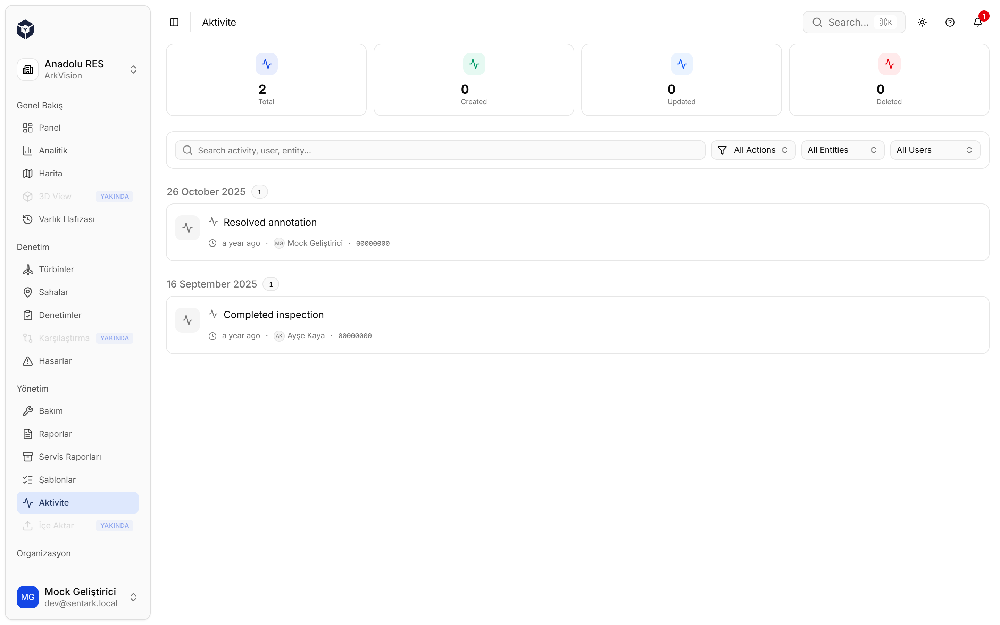

import { Callout } from '@prosefly/astro-components';

Aktivite günlüğü, organizasyonunuzda yapılan tüm işlemlerin kaydıdır. Kim bir denetim oluşturdu, kim bir hasarı sildi, kim üye davet etti gibi soruların cevabı burada zaman çizelgesi olarak listelenir. Kayıtlar otomatik tutulur; ayrıca bir şey yapmanız gerekmez.

Bu ekran iki açıdan değerlidir. Birincisi hesap verebilirlik: bir kaydın kim tarafından değiştirildiğini bilmek, ekip içinde güven oluşturur. İkincisi sorun çözme: beklenmedik bir değişiklik olduğunda, örneğin bir denetimdeki hasarlar kaybolduğunda, aktivite kaydı ne olduğunu anlamanın en hızlı yoludur.

## Zaman çizelgesi

Aktivite sayfası işlemleri en yeniden en eskiye doğru listeler. Her kayıtta işlemi yapan kullanıcı, işlem türü, etkilenen kayıt ve tarih bilgisi yer alır. Uzun bir geçmişte aradığınızı bulmak için filtreleri kullanırsınız.

## Filtreleme

Zaman çizelgesi üç eksende filtrelenebilir: kullanıcı, işlem türü ve tarih aralığı. Örneğin belirli bir kullanıcının son bir haftadaki işlemlerini veya tüm silme işlemlerini listeleyebilirsiniz.

Bu filtreler özellikle şu durumlarda işe yarar: bir hasarın nasıl silindiğini araştırırken silme işlemlerini listelemek; bir ekibin belirli bir dönemde ne kadar iş yaptığını görmek; beklenmedik bir değişikliğin hangi kullanıcıdan geldiğini bulmak.

<Callout type="tip" title="Bir şey kaybolduysa önce buraya bakın">
  Bir denetim, hasar veya görüntü beklenmedik şekilde değişmişse aktivite
  günlüğü ne olduğunu söyler. Silme işlemleri geri alınamaz ama kaydı her
  zaman burada durur.
</Callout>

## Kayıtların kapsamı

Aktivite günlüğü organizasyon düzeyindedir. Yalnızca sizin organizasyonunuzdaki işlemleri gösterir; diğer organizasyonların kayıtları görünmez. Kayıtlar silinemez ve düzenlenemez, bu da günlüğün güvenilir bir referans olmasını sağlar.

Günlük, denetim süreçlerinin izlenmesi için de kullanılabilir. Örneğin bir denetimin hangi aşamalardan ne zaman geçtiğini, kimlerin inceleme yaptığını ve raporun ne zaman üretildiğini bu kayıtlardan takip edebilirsiniz.
